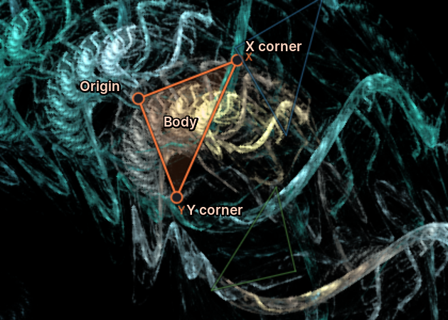
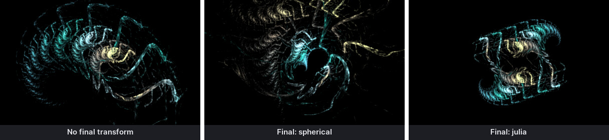
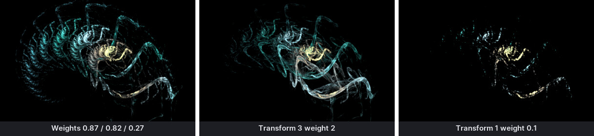
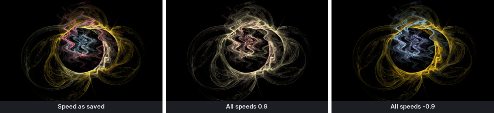
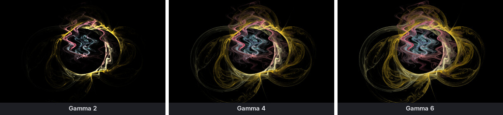
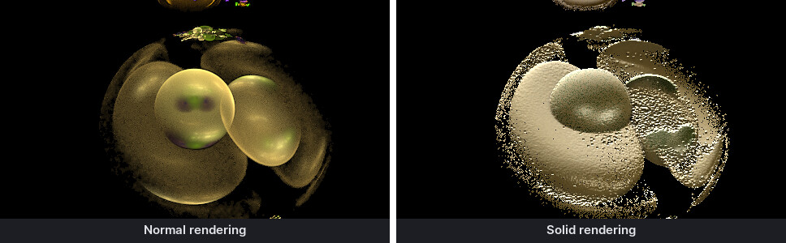

# How fractal flames work

A fractal flame is not drawn line by line. It is the *picture of a process*: a point jumps
around the plane millions of times, and every place it visits gets a little brighter. Which
way it jumps is decided by a handful of rules, the **transforms**. This chapter explains these
rules and the terms that the rest of the manual uses. You do not need any mathematics to make
beautiful flames, but knowing what happens behind the preview makes the controls much less
mysterious.

## The chaos game

RWildFire starts with a random point. Then it repeats, millions of times per second:

1. Pick one of the transforms at random. Transforms with a higher **weight** are picked more
   often.
2. Move the point with that transform. The transform first applies its **affine** (move, turn,
   scale, shear), then its **variations** (bend, twist, fold), then optionally a **post
   affine**.
3. Mix the point's color towards the transform's color.
4. If a **final transform** exists, apply it to a copy of the point. Then put a dot of the
   point's color where the copy lands in the image.

After the first few steps, the point no longer depends on where it started: it moves around
on the *attractor* of the transforms, the shape that the flame shows. Places the point visits
often become bright, places it rarely visits stay dark. Because the jumps are random, the
image starts grainy and becomes smoother the more points are drawn; the **quality** setting
says how many.

## Transforms

A transform is one rule of the chaos game. Each transform has:

| Part | What it does |
|------|--------------|
| **Weight** | How often the transform is picked, relative to the others. A transform with weight 2 is picked twice as often as one with weight 1. |
| **Affine** | A linear transformation: it moves, rotates, scales, mirrors and shears the point. On the canvas it is shown as a triangle. |
| **Variations** | Non-linear functions that bend the point: `spherical`, `julia`, `swirl`, `bubble` and more than 1000 others. Their results are added up, each scaled by its *amount*. |
| **Post affine** | A second affine applied after the variations. |
| **Color** and **speed** | The position in the gradient that the transform pulls points towards, and how strongly. |
| **Opacity** | How much the transform's dots count in the image. With opacity 0, points still pass through the transform, but leave no trace. |
| **Xaos** | Optional: which transform may follow which (see below). |

A flame usually has two to six transforms. Even two transforms with the right variations
make astonishing shapes.

### The affine triangle

An affine is described by three points: where it moves the origin (0,0), the point (1,0) and
the point (0,1). The canvas draws exactly this as a triangle:

{: .half}

- The **origin** corner says where the transform moves the center.
- The **X corner** says where the unit point on the x-axis goes. Its distance from the origin
  is the scale along x; its direction is the rotation.
- The **Y corner** does the same for the y-axis.

A triangle that is smaller than the unit triangle *shrinks* the points. Transforms must shrink
on average, or the points fly off to infinity and the image stays empty. If a triangle is
mirrored (X and Y corners swapped compared to the usual orientation), the transform mirrors
the image.

In numbers, the affine has six coefficients. RWildFire shows them as *X axis* (`c00`, `c01`),
*Y axis* (`c10`, `c11`) and *Origin* (`c20`, `c21`): the X corner relative to the origin, the
Y corner relative to the origin, and the origin itself. JWildfire calls them coeff00 to
coeff21; flam3 and Apophysis call them a, b, c, d, e, f.

### Variations

Variations are what makes flames look like flames instead of geometric fractals. A variation
takes the point (after the affine) and moves it according to its formula: `spherical`
inverts it at the unit circle, `swirl` turns it by an angle that grows with the distance,
`julia` takes a square root, `bubble` maps the plane onto a sphere. Many variations have
**parameters** that change their shape, e.g. the `power` of `julian`.

The **amount** of a variation scales its result. When a transform has several variations,
their results are added: `linear 0.5` plus `swirl 0.5` gives a mix of both. The variation
`linear3D` (or `linear`) leaves the point unchanged, so it is the neutral ingredient.

Some variations only make sense before or after the others. **Pre** variations (prefix
`pre_`, e.g. `pre_blur`) work on the point before the normal variations, **post** variations
(`post_`) afterwards. Every variation can be moved into the pre or post slot with the small
*pre* and *post* buttons in the variation list.

**3D variations** also move the point in depth (z). They only show their full effect when the
camera looks at the flame from an angle (pitch, yaw, perspective).

### Final transform

A final transform is applied to every point *before it is drawn*, but its result is not fed
back into the chaos game. It therefore changes the whole image at once like a lens: a
final `spherical` wraps the flame into a sphere, a final `julia` duplicates it. A flame can
have several final transforms; they are applied one after the other.

### Background transforms

Background transforms (from JWildfire) render behind the flame: they color the background with
patterns instead of a plain color. They have their own list in the transforms panel.

## Weights and xaos

The **weight** decides how often a transform is chosen. Raising one weight makes the shapes
of that transform more prominent and the others fainter:

**Xaos** (from "chaos") goes further: it gives each *pair* of transforms its own weight. The
xaos value from transform A to transform B multiplies B's weight whenever the point was last
moved by A. With xaos you can forbid sequences (value 0), favour them (values above 1) or
build flames in which one transform always follows another. Without xaos all values are 1.

## Color

Every point carries a color index between 0 and 1 that points into the **gradient**, a strip of
256 colors. When a transform moves a point, it mixes the index towards its own color position.
The **speed** decides how far: speed 0 goes halfway, speed 1 keeps the old index, speed −1 jumps
fully to the transform's color. Points that took a certain path through the transforms thus get
a typical color, which is why flame colors follow the structure so naturally.

There are further coloring modes (target colors, distance, cyclic); chapter "Transforms and
variations" explains them. Some variations also set colors themselves, e.g. those that read an
image.

## From points to an image: tone mapping

The chaos game counts how often each pixel was hit and adds up the colors of the hits. The
counts vary enormously: a bright spot may have been hit a million times more often than a
faint veil. **Tone mapping** turns these counts into visible brightness using a logarithm, so
that faint and bright structures are visible at the same time:

- **Brightness** scales everything.
- **Gamma** lifts the faint parts relative to the bright ones. Higher gamma shows more of the
  veils.
- **Vibrancy** decides whether gamma works on each color channel separately (0: colors wash out
  towards white in bright areas) or on the brightness only (1: colors stay saturated).
- **White level** is the point at which colors start to clip to white.

## Quality, noise and filtering

Because the points are random, a render is grainy at first. The **quality** (JWildfire's
"sample density") is the average number of points drawn per pixel. Doubling it halves the
remaining grain only partly: noise falls with the square root of the quality, so going from
grainy to clean usually means going from tens to thousands.

Three tools smooth the image without needing more points:

- The **spatial filter** spreads every point over a few neighbouring pixels (filter radius).
- **Density estimation** (DE) blurs sparse areas more and dense areas less, so faint regions
  look smooth while detail stays sharp.
- The **AI denoiser** removes remaining grain after rendering, see "Render settings".

## 2D and 3D

Flames are computed in three dimensions. Most flames stay flat (all points have z = 0), but 3D
variations and 3D affines give them depth. The **camera** decides how the 3D points are
projected into the image: turning it (pitch, yaw, bank), moving it, adding perspective and depth
of field. **Solid rendering** goes further and renders 3D flames as lit surfaces with shadows
and ambient occlusion.

## Layers

A flame can have several **layers**. Each layer is a complete set of transforms with its own
gradient; all layers are rendered into the same image. Layers make it possible to combine
flames, e.g. a structure and a soft glow, without the two influencing each other's chaos game.

## Flame files

A flame is saved as XML text in a `.flame` file. One file can hold several flames. The format
is the one of JWildfire and, for simple flames, of flam3 and Apophysis. Because flames are
text, they can be copied and pasted (Ctrl+C, Ctrl+V) to share them in forums and chats.
