# The editor window

RWildFire has one main window. Its parts are always in the same place:

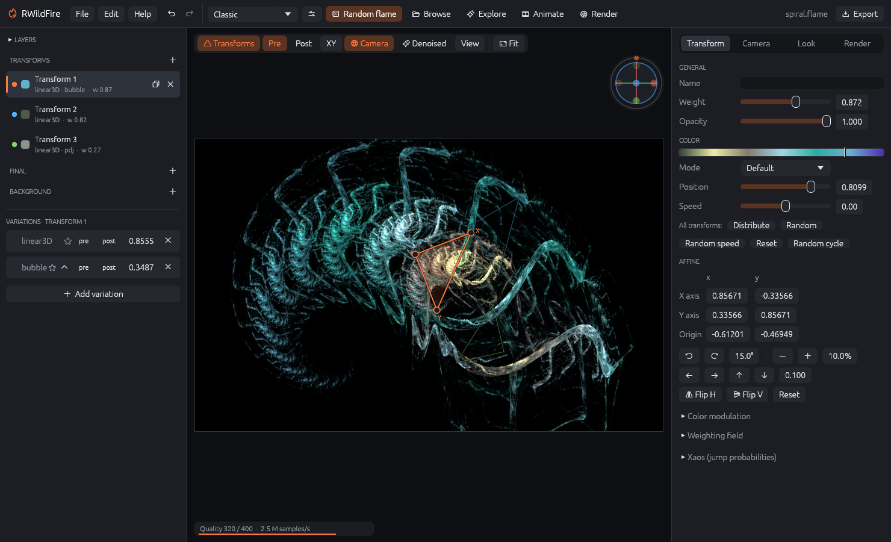

| Area | Position | Purpose |
|------|----------|---------|
| Top bar | top | Menus, undo/redo, random flames, the switches for the workspaces (Browse, Explore, Animate, Render), Export |
| Transforms panel | left | Layers, the list of transforms, final and background transforms, and the variations of the selected transform |
| Canvas | center | The live preview with the transform handles and the canvas toolbar |
| Inspector | right | Four tabs with all settings: Transform, Camera, Look, Render |
| Strips | bottom (optional) | The Explore strip and the animation timeline, when switched on |

The panels on the left and right can be made wider by dragging their inner edge. The window
title shows the name of the open file; a dot (•) after the name means there are unsaved
changes.

## The top bar

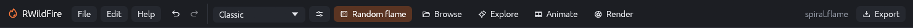

From left to right:

- **File**, **Edit** and **Help** menus (see below).
- **Undo** and **Redo** (<kbd>Ctrl</kbd>+<kbd>Z</kbd>, <kbd>Ctrl</kbd>+<kbd>Shift</kbd>+<kbd>Z</kbd>
  or <kbd>Ctrl</kbd>+<kbd>Y</kbd>). RWildFire keeps the last 200 steps. A drag on the canvas or a
  slider counts as one step, recorded when you release the mouse.
- The **generator** menu (here "Classic") chooses the random flame generator that
  **Random flame** uses. Chapter "Making flames" describes the generators.
- The **sliders button** next to it holds the extras for random flames: symmetry, weighting
  field, gradient generator and the variation profile.
- **Random flame** (<kbd>Space</kbd>) replaces the editor's flame by a new random flame. Some
  generators render a few test images to make sure the flame fills the frame; while they work,
  the button reads "Generating…". The old flame is one undo step away.
- **Browse** opens the flame browser (thumbnails of a folder).
- **Explore** shows the Explore strip below the canvas (random batches, quick mutations, the
  flames of a file, MutaGen).
- **Animate** shows the timeline.
- **Render** opens the render workspace. A dot after "Render" means a job is running there.
- On the right: the file name and **Export** (<kbd>Ctrl</kbd>+<kbd>E</kbd>), the dialog to save
  images and animations.

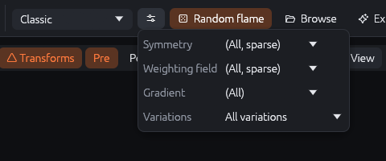{: .half}

## Menus

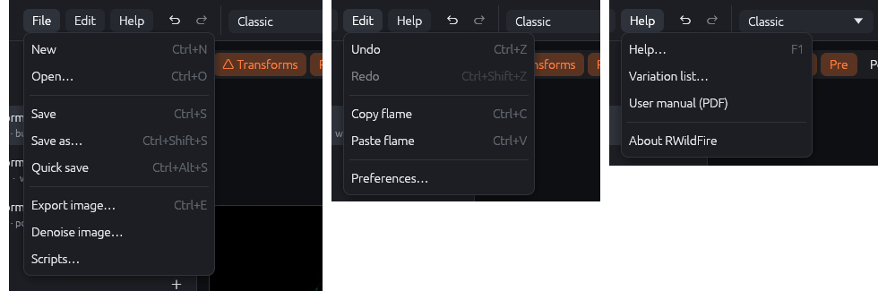

### File

| Command | Shortcut | What it does |
|---------|----------|--------------|
| New | <kbd>Ctrl</kbd>+<kbd>N</kbd> | A new, simple flame with the settings for new flames from the preferences. |
| Open… | <kbd>Ctrl</kbd>+<kbd>O</kbd> | Opens a `.flame` file. If it holds several flames, the first one goes into the editor and all of them appear in Explore › File. You can also drop files onto the window. |
| Save | <kbd>Ctrl</kbd>+<kbd>S</kbd> | Saves into the open file (asks for a name the first time). |
| Save as… | <kbd>Ctrl</kbd>+<kbd>Shift</kbd>+<kbd>S</kbd> | Saves under a new name. |
| Quick save | <kbd>Ctrl</kbd>+<kbd>Alt</kbd>+<kbd>S</kbd> | Saves a copy as `qsave_<date>_<number>.flame` in the quick save folder, without asking. Handy to keep interesting intermediate states. |
| Export image… | <kbd>Ctrl</kbd>+<kbd>E</kbd> | Renders and saves an image or animation (chapter "Exporting"). |
| Denoise image… | | Runs the AI denoiser on any PNG or JPEG file. |
| Scripts… | | Opens the scripts window (chapter "Scripting"). |
| Quit | <kbd>Ctrl</kbd>+<kbd>Q</kbd> | Closes RWildFire, like the window's close button. If the flame has unsaved changes, RWildFire asks first (see below). |

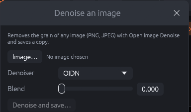{: .third}

**Denoise image…** removes the grain of any PNG or JPEG file, e.g. renders from other
programs: choose the **Image…**, the **Denoiser** (OIDN on the CPU or on an NVIDIA GPU) and the
**Blend** (how much of the original is mixed back in), then **Denoise and save…** writes a copy.

### Edit

| Command | Shortcut | What it does |
|---------|----------|--------------|
| Undo / Redo | <kbd>Ctrl</kbd>+<kbd>Z</kbd> / <kbd>Ctrl</kbd>+<kbd>Shift</kbd>+<kbd>Z</kbd> | Steps back and forth through the changes. |
| Copy flame | <kbd>Ctrl</kbd>+<kbd>C</kbd> | Copies the flame as XML text, e.g. to paste into a forum post, a chat or JWildfire. |
| Paste flame | <kbd>Ctrl</kbd>+<kbd>V</kbd> | Loads a flame from the clipboard (RWildFire, JWildfire or Apophysis XML). Pasting several flames shows them in Explore › File. |
| Preferences… | | Settings that stay between sessions (chapter "Preferences"). |

<kbd>Ctrl</kbd>+<kbd>C</kbd> and <kbd>Ctrl</kbd>+<kbd>V</kbd> act on flames only while no text field
has the keyboard focus; inside a text field they copy and paste text as usual.

### Help

**Help…** (<kbd>F1</kbd>) opens the help window with the tabs *Getting started*, *Shortcuts*,
*FAQ*, *Coloring types*, *Variations*, *Scripting* and *About*. **Variation list…** opens it on
the variation list: all variations with their parameters, searchable, and filters for 3D
variations and GPU support. **User manual (PDF)** opens this manual in your PDF viewer.

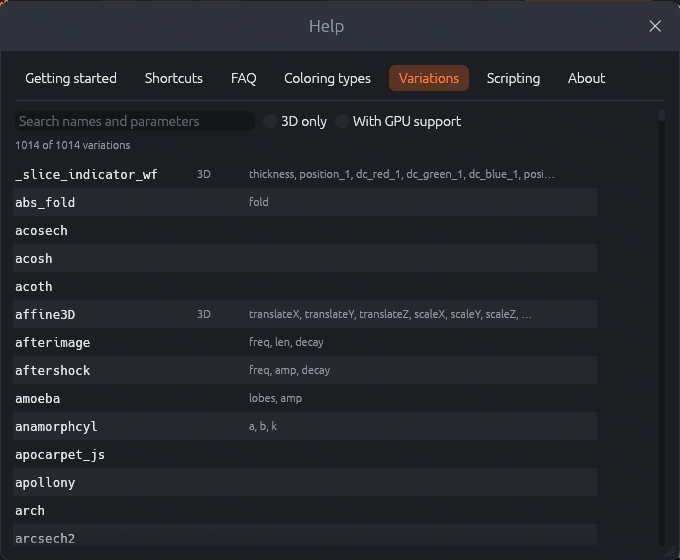{: .half}

## The canvas

The canvas shows the flame as it will be rendered, in the aspect ratio of the flame's image
size. The preview refines continuously: it starts grainy and becomes smoother until it reaches
the target quality. The status line at the bottom shows the progress, e.g.
"Quality 183 / 400 · 2.4 M samples/s", and "done" when the target is reached. Every change
restarts the preview.

### Working with the mouse

| Action | Result |
|--------|--------|
| Drag the body of a triangle (or its origin corner) | Moves the transform. |
| Drag the X or Y corner | Turns and scales that axis freely (the corner follows the mouse). |
| <kbd>Shift</kbd> + drag a corner | Only turns the transform around its origin. |
| <kbd>Ctrl</kbd> + drag a corner | Only scales the transform (which axes: canvas toolbar › XY menu). |
| Click a triangle | Selects the transform. |
| Drag the empty background (any mouse button) | Moves the view (changes the flame's center). |
| Mouse wheel | Zooms around the mouse pointer (changes the scale). |
| Double-click | Configurable in the preferences: nothing, open the render workspace, or show/hide the handles. |

{: .half}

Each normal transform has its own color, shown both in the transforms list and on its
triangle. Final transforms are drawn in light gray, background transforms in brown, both with
dashed lines. The selected transform is drawn solid and slightly filled.

### Keyboard

While the canvas or the editor has the focus (not a text field):

| Key | Result |
|-----|--------|
| Arrow keys | Move the selected transform by the move step (inspector › Transform). <kbd>Ctrl</kbd>: a tenth, <kbd>Shift</kbd>: ten times. |
| <kbd>Alt</kbd>+<kbd>←</kbd> / <kbd>Alt</kbd>+<kbd>→</kbd> | Turn the selected transform by the rotation step. |
| <kbd>Alt</kbd>+<kbd>↑</kbd> / <kbd>Alt</kbd>+<kbd>↓</kbd> | Scale the selected transform up or down by the scale step. |
| <kbd>F</kbd> | Fit the flame into the view. |
| <kbd>Delete</kbd> | Remove the selected transform. |
| <kbd>Space</kbd> | New random flame; play/pause while the timeline is open. |

### The canvas toolbar

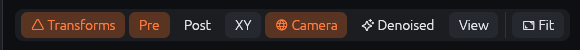

- **Transforms** shows or hides the triangles.
- **Pre** / **Post** chooses which affine the triangles edit: the normal (pre) affine or the
  post affine. The post affine is drawn dashed.
- **XY** opens the edit plane menu:

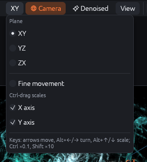{: .third}

  - *Plane*: XY edits the usual affine. YZ and ZX edit the extra affines that 3D transforms
    have in these planes (JWildfire's "edit plane"); use them to turn 3D transforms out of the
    image plane.
  - *Fine movement*: dragging moves, turns and scales at a tenth of the speed, for precise
    adjustments.
  - *Ctrl-drag scales*: which axes <kbd>Ctrl</kbd>+drag scales (X, Y or both). Scaling only one
    axis stretches the transform.
- **Camera** shows the orbit globe in the top right corner of the canvas. Drag it to turn the
  camera in 3D (see chapter "Camera").
- **Denoised** shows the finished preview through the flame's AI denoiser, as saved images will
  look. It waits until the preview has reached its target quality.
- **View** opens the view options:

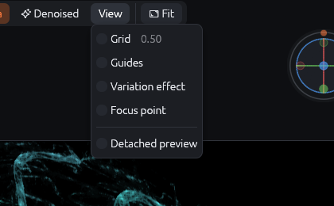{: .third}

  - *Grid* draws lines in world units (the zero lines brighter); *Grid spacing* sets their
    distance. Useful to place transforms precisely.
  - *Guides* draws composition lines: the center (white), the rule of thirds (red) and the
    golden ratio (green).
  - *Variation effect* shows how the selected transform bends a regular grid over the square
    from −1 to 1. It is the quickest way to understand what a variation does.
  - *Focus point*: while on, dragging on the canvas moves the depth-of-field focus point
    instead of the view (for the "Focus point" depth of field mode).
  - *Detached preview* shows the preview in a separate window as well, e.g. on a second
    screen at full size.
- **Fit** (<kbd>F</kbd>) centers and scales the view so that the whole flame is visible.

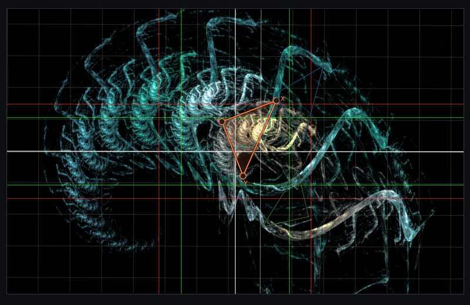

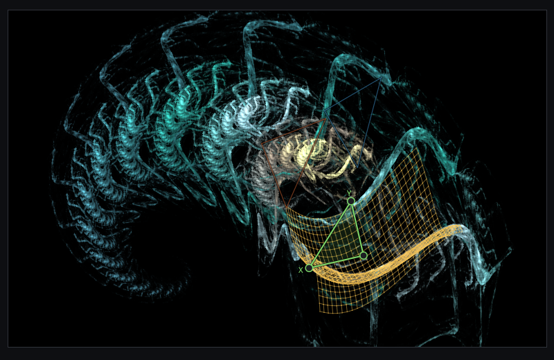

## Files and the window title

RWildFire remembers which file the flame came from, and **Save** writes the edited flame back
into it. Random flames, pasted flames and MutaGen results have no file until you save them.
Opening files works with the menu, by dropping files onto the window or by passing them on the
command line (`rwf-app my.flame`). A dropped or passed `.rwfdance` project opens in the dancing
flames workspace; JWildfire movies (`.jwfmovie`) are opened in Render › Movie.

When you quit (File › Quit, <kbd>Ctrl</kbd>+<kbd>Q</kbd> or the window's close button) while the
flame has unsaved changes, RWildFire asks **Save changes?**: **Save** saves the flame (asking
for a file name if it has none yet) and quits, **Don't save** quits without saving, **Cancel**
keeps RWildFire open. It also warns when a job in the render workspace (batch, quilt, movie,
dance video, mesh sampling) is still running, because quitting stops it.

Files with several flames keep all of them when you save. **Save** writes the edited flame back
into its place in the file (the first flame when the file was opened, or the flame you picked in
Explore › File); the other flames stay unchanged. A flame that did not come from this file, such
as a random flame, is added at the end. The status line says which flame was written, e.g.
"Saved … (flame 2 of 3)". **Save as…** into a new file writes the edited flame alone.
