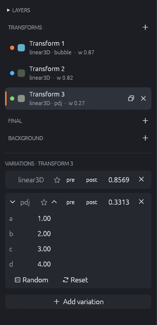
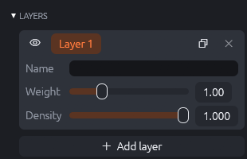
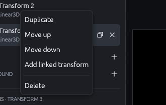
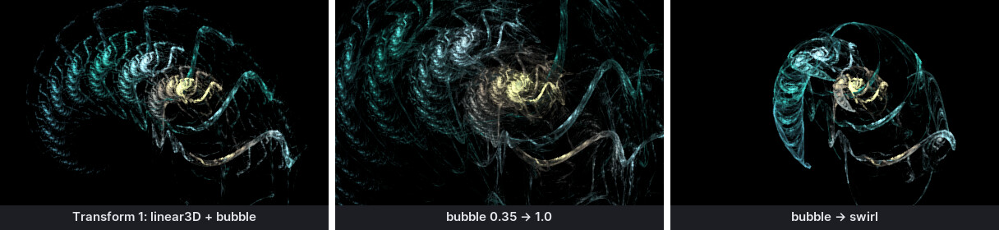
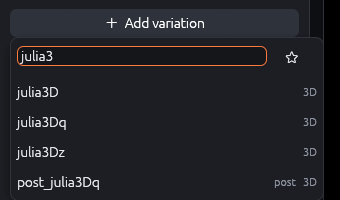
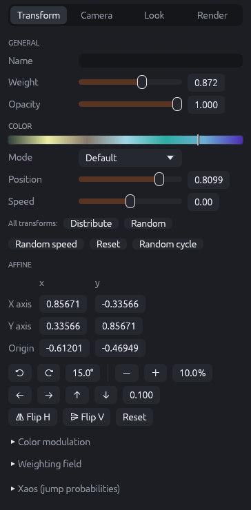
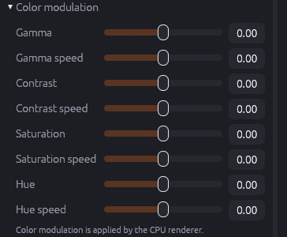
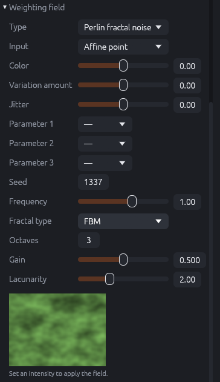
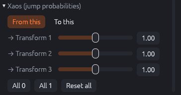

# Transforms and variations

The transforms are the heart of a flame. You edit them in two places: the **transforms panel**
on the left (which transforms exist, their variations and parameters) and the **Transform**
tab of the inspector on the right (weight, color, affine and more for the selected transform).

{: .half}

## Layers

The **Layers** section at the top is collapsed for flames with one layer. Open it to see the
list of layers:

{: .half}

- Click a layer's name to select it. The transforms panel, the gradient and the xaos always
  show the selected layer.
- The **eye** shows or hides a layer. Hidden layers are not rendered and not changed by
  mutations.
- **Duplicate** (two squares) inserts a copy after the layer; **×** deletes it (a flame keeps at
  least one layer).
- For the selected layer: **Name**, **Weight** and **Density**. *Weight* multiplies the
  brightness of every point the layer draws: a layer with weight 2 shines twice as strongly as
  one with weight 1, so the weights balance the layers against each other. *Density* (0 to 1)
  lets the layer draw only part of its points: lower values make the layer fainter and more
  grainy, like a veil.
- **Add layer** creates a new layer with one transform and the current gradient.

## The transform list

Each row shows the transform's name (or "Transform 1", "Transform 2", …), its variations, its
weight and its color: the small square is the transform's color in the gradient, the dot is
its handle color on the canvas.

- Click a row to select the transform. Hovering a row shows **Duplicate** and **Delete**.
- The **+** in the section header adds a transform (`linear3D`, half size).
- Right-click a row for more:

{: .third}

| Command | Effect |
|---------|--------|
| Duplicate | Inserts a copy after the transform (including its xaos). |
| Move up / Move down | Changes the order. The order matters for xaos and for scripts and paths that refer to transforms by number. |
| Add linked transform | Adds a new transform that always follows this one: the new transform takes over this transform's xaos, this transform only jumps to the new one and is made invisible (opacity 0). The result is a transform that is "linear + something" in two steps, a classic Apophysis technique for more complex shapes. |
| Delete | Removes the transform. <kbd>Delete</kbd> does the same for the selected transform. |

The **Final** and **Background** sections work the same way. A new final transform is a
`linear3D` that changes nothing until you add variations or change its affine; a new
background transform is a random background pattern.

## Variations

Below the transform lists, the **Variations** section shows the variations of the selected
transform, in the order in which they are applied.

Each variation row has:

- an **arrow** to open its parameters (only for variations with parameters),
- its **name** (orange: the variation is unknown to this version; it is kept in the file but
  ignored when rendering. Hover the name to see "CPU only" for the few variations without GPU
  support),
- a **star** to add it to the favourites,
- an **up arrow** to move it before the previous one (the order matters when variations are in
  different slots and for some special variations),
- **pre** and **post** to move it into the pre or post slot,
- the **amount**, a number you can drag or type,
- **×** to remove it.

### What the amount does

The amount scales the variation's contribution. With a single variation it scales the result
(and thus, roughly, the size of what the transform produces). With several variations it sets
the mix. Negative amounts mirror the contribution. Small changes of the amount often change the
flame drastically, because every point passes through the transform many times.

### Parameters

Opened, a variation lists its parameters. Drag a value sideways to change it, or double-click
to type a value. Integer parameters (like `power` of `julian`) take whole numbers.

- **Random** sets all parameters to random values within their usual ranges: a quick way to
  explore what a variation can do.
- **Reset** returns them to their defaults.
- Variations with **presets** (e.g. the formula plots `parplot2d_wf`, `polarplot3d_wf`) show a
  preset menu instead of the id number; choosing a preset sets all its parameters.
- Variations with **resources** show file pickers: images (`plane_wf`, `colormap_wf`,
  `brush_stroke_wf`, …), SVG files (`svg_wf`), meshes (`obj_mesh_wf`), embedded flames
  (`subflame_wf`) and texts (`text_wf`). Images can be referenced by file or embedded into the
  flame (**Embed…**), so the flame file works on other computers too.

### Adding variations

**Add variation** opens a searchable list of all variations:

{: .half}

Type part of a name to filter. Favourites (marked with the star) are listed first; the star
button next to the search field shows only favourites. Tags on the right say whether a
variation is **3D**, belongs to the **pre**, **post** or **prepost** slot by default, or runs
on the **CPU** only. The first variation of a transform is added with amount 1, further ones
with 0.5.

The help window (Help › Variation list…) shows all variations with their parameters, if you
are looking for one with a certain parameter.

## The Transform tab

The Transform tab of the inspector shows the settings of the selected transform.

{: .half}

### General

- **Name**: optional; shown in the list instead of "Transform n".
- **Weight**: how often the transform is chosen (logarithmic slider from 0.001 to 50; any
  value can be typed). Only normal and background transforms have a weight.
- **Opacity**: how much the transform's points show in the image. 1 is normal; values between
  0 and 1 make the transform's contribution translucent; 0 hides it completely while it still
  takes part in the chaos game. Hidden transforms are useful as "helpers" that move points
  without drawing them.

### Color

The gradient strip shows the gradient with a marker at the transform's color position.

- **Mode**: the coloring type (see the table below). *Default* means: Diffusion for normal
  transforms, None for final transforms.
- **Position**: the transform's color, a position in the gradient from 0 (left) to 1 (right).
- **Speed** (JWildfire's "color symmetry"): how strongly the transform pulls the point's color
  towards its position. 0 goes halfway, 1 keeps the incoming color, −1 jumps all the way. With
  high speeds, colors spread across the flame; with low or negative speeds each transform
  "paints" its own area.
- **Target** (only with the Target color mode): the RGB target color.

| Mode | What happens to the point's color |
|------|-----------------------------------|
| None | The color is kept unchanged. Default for final transforms, since anything else would narrow the colors. |
| Diffusion | The standard flame coloring: the gradient index moves towards Position, by Speed. |
| Target color | Ignores the gradient: the color is blended towards the target color, by Speed. |
| Target (gradient) | Like Target color, but the target comes from the gradient at Position, so it follows gradient changes. |
| Distance | The color comes from the gradient at the distance the transform moved the point, starting at Position, with Speed as the scale. The incoming color is ignored. Good for flames with a single non-blur transform. |
| Cyclic | Shifts the gradient index by Speed and wraps around. It never settles on its own, so another transform must use Diffusion. Speeds like 1/n cycle through n colors, which suits tilings. |

The buttons below act on **all transforms** of the layer:

- **Distribute** spreads the color positions evenly over the gradient (first transform 0, last
  1). A good start for flames that look single-colored.
- **Random** gives every transform a random position; **Random speed** random speeds.
- **Reset** sets all positions and speeds to 0.
- **Random cycle** sets a random color cycle (Look tab), which shifts all colors along the
  gradient without changing the gradient itself.

### Affine

The **Affine** section shows the coefficients of the affine being edited. Its title changes
with the canvas toolbar: *Post affine* when Post is chosen, *(YZ)* or *(ZX)* for the 3D edit
planes.

| Row | Meaning |
|-----|---------|
| X axis (x, y) | Where the unit x vector goes: the X corner relative to the origin (`c00`, `c01`). |
| Y axis (x, y) | Where the unit y vector goes (`c10`, `c11`). |
| Origin (x, y) | The translation: where the center goes (`c20`, `c21`). |

The buttons below change the affine in steps:

- **↺ / ↻** turn counter-clockwise / clockwise by the angle next to them (15° by default).
- **− / +** shrink and grow by the percentage next to them (10% by default).
- **← → ↑ ↓** move the origin by the step next to them (0.1).
- **Flip H** mirrors the X axis, **Flip V** the Y axis.
- **Reset** returns the affine to the identity (no change).

The steps are also used by the arrow keys on the canvas.

### Color modulation

{: .half}

Color modulation (JWildfire) changes the gamma, contrast, saturation and hue of the points this
transform produces. Every point carries these four modulation values along, just like its
color index. Each transform pulls them towards its own values (**Gamma**, **Contrast**,
**Saturation**, **Hue**), and the matching **speed** says how strongly, exactly like the color
speed: 0 halfway, 1 not at all, −1 all the way. So the modulation of a transform shows most in
the parts of the flame that the transform shapes. Color modulation is applied by the CPU
renderer only; the GPU preview and GPU renders ignore it.

### Weighting field

{: .half}

A weighting field (JWildfire 8) is a 2D noise pattern or an image laid over the plane. Where a
point lands on the field, the field's value (−1 to 1) can change the transform's effect:

- **Type**: the pattern: cellular, cubic, Perlin, simplex or value noise (each also as
  "fractal" noise with several octaves), white noise, or an **image map**.
- **Input**: which position looks up the field: the point after the affine (*Affine point*) or
  before it (*Source point*).
- **Color**: how much the field shifts the point's color. Gives structures color variation that
  follows the noise.
- **Variation amount**: how much the field scales the amounts of the variations. Makes parts of
  the flame stronger or weaker depending on the place.
- **Jitter**: random displacement scaled by the field, for a grainy, textured look.
- **Parameter 1–3**: choose a variation parameter of this transform that the field modulates,
  with its own intensity.
- **Seed**, **Frequency** (size of the noise structures: higher is finer), and for fractal
  noise **Fractal type**, **Octaves**, **Gain** and **Lacunarity** shape the noise. For
  cellular noise, **Return** and **Distance** choose the cell function. For an image map:
  **Image**, **Width**, **Height**, **Centre X**, **Centre Y** place the image in the plane.

The small preview shows the field. Nothing happens until at least one intensity is not 0
("Set an intensity to apply the field"). The section title shows "(on)" when the field is
active.

### Solid material

With solid rendering switched on (Render tab), each transform has a **Material** index that
picks one of the materials defined there; fractional values blend two neighbouring materials.
**Material speed** works like the color speed for materials.

### Xaos

{: .half}

The **Xaos** section (only with two or more transforms) shows the jump weights of the
selected transform:

- **From this**: how likely each transform is chosen *after* this one. "→ Transform 2 = 0"
  means: after this transform, transform 2 is never chosen.
- **To this**: how likely this transform is chosen after each of the others.

Values are relative weights from 0 to 2 (higher values can be typed). **All 0** and **All 1**
set the values shown; **Reset all** removes the xaos of all transforms.

!!! tip
    Setting a transform's xaos to itself to 0 ("→ Transform n" in its own From list) stops
    the transform from being applied twice in a row. This often removes blurry clouds and
    brings out the structure.
