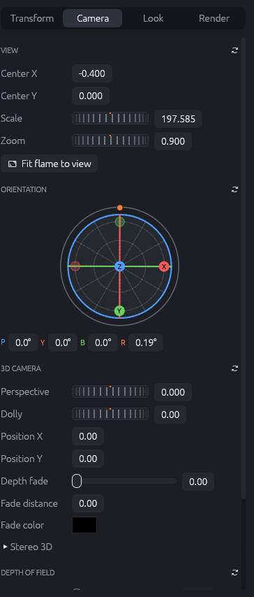
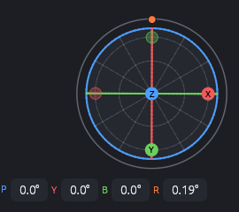
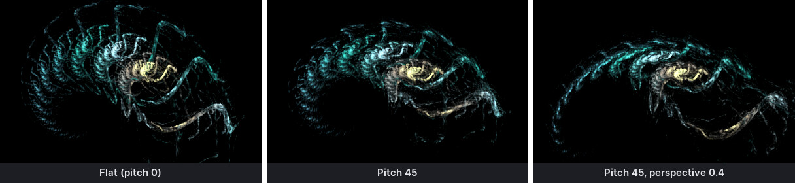
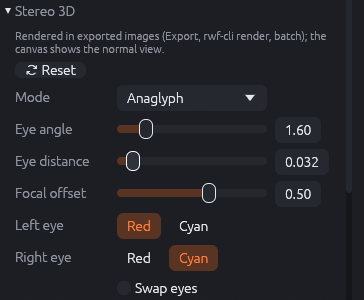
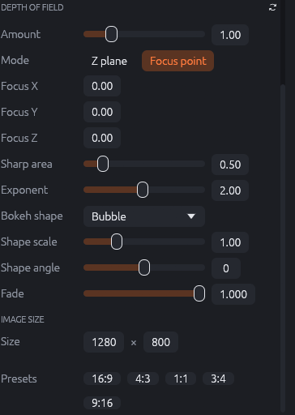
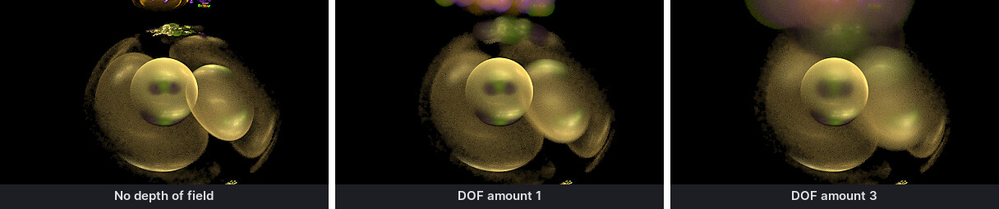

# Camera

The **Camera** tab of the inspector decides how the flame is put into the picture: which part
is visible, how large, from which direction a 3D flame is seen, with which depth effects, and
at which image size. Each section header has a reset button (↻) on the right that returns the
section to its defaults.

{: .half}

## View

- **Center X / Center Y**: the point of the flame that appears in the middle of the image.
  Dragging the canvas background changes it.
- **Scale**: pixels per unit, i.e. how large the flame appears. The mouse wheel on the canvas
  changes it around the mouse pointer.
- **Zoom**: the camera zoom. It also enlarges the flame, but in 3D it acts like a lens (it
  zooms the projected image) while Scale is the size of the flame's coordinate system. For 2D
  flames both look the same.
- **Fit flame to view** (also <kbd>F</kbd> on the canvas) finds the bulk of the points and
  centers and scales the view to show them.

Scale and Zoom use **thumbwheels**: drag sideways to change the value (logarithmically, so
small and large values are equally easy to reach), hold <kbd>Shift</kbd> for fine steps,
double-click to reset. You can also type the value into the field next to the wheel.

## Orientation

{: .third}

The orientation turns the camera around the flame. For flat (2D) flames only the
**rotation** (R) matters: it turns the image. For 3D flames the other angles show the flame
from other directions:

| Angle | Effect |
|-------|--------|
| **P**itch | Tilts the flame forwards and backwards (around the horizontal axis). |
| **Y**aw | Spins the flame around the axis perpendicular to the flame plane. |
| **B**ank | Tilts the flame sideways. |
| **R**otation | Turns the image in the image plane (JWildfire's "roll" / angle). |

The **orbit globe** makes this intuitive:

- Drag the ball to orbit the camera freely.
- Drag a ring to change one angle: the blue ring is yaw, the red one pitch, the green one bank;
  the outer gray ring is the rotation.
- Click an axis dot (X, Y, Z) to look along that axis.
- Double-click resets the orientation; <kbd>Shift</kbd> snaps to 15° steps.

The same globe appears in the top right corner of the canvas when **Camera** is switched on
in the canvas toolbar.

## 3D camera

- **Perspective**: 0 is a parallel projection; higher values make near parts larger and far
  parts smaller. Only visible when the flame is tilted (pitch, bank) or has depth.
- **Dolly**: moves the camera along its viewing axis (camera position Z). With perspective, the
  flame grows as the camera comes closer.
- **Position X / Y**: moves the camera sideways and up/down in 3D (unlike Center, which moves
  the image).
- **Depth fade**: darkens points the farther they are from the camera (JWildfire's "dimish
  z"). 0 is off; higher values fade faster.
- **Fade distance**: shifts where the fading starts.
- **Fade color**: the color distant points fade into. Black (the default) just makes them
  darker; a fog color gives an atmospheric look.

## Stereo 3D

{: .half}

Stereo 3D renders the flame for two eyes. It is applied to **exported** images (Export,
`rwf-cli render`, the batch renderer); the canvas always shows the normal view.

- **Mode**: *Anaglyph* (one image for red/cyan glasses), *Side by side* (both eye images next
  to each other, for cross-eyed or parallel viewing, VR viewers and 3D TVs), or *Interpolated
  pairs* (several side-by-side pairs at growing eye distance, one row each: good to find the
  best eye distance).
- **Eye angle**: how far each eye turns towards the focal point (degrees). Larger values give
  a stronger 3D effect, but too much makes the image hard to fuse.
- **Eye distance**: how far each eye is moved from the center.
- **Focal offset**: the depth of the point the eyes turn around. Things at this depth appear on
  the screen plane; nearer things come out of it, farther ones go behind it.
- **Left eye / Right eye** (anaglyph): which color filter each eye uses.
- **Pairs** (interpolated): the number of rows.
- **Swap eyes**: for cross-eyed viewing or glasses with swapped colors.

Each eye image gets its share of the quality, as in JWildfire. Stereo images are saved as PNG
or JPEG, without z-buffer or HDR.

## Depth of field

{: .half}

Depth of field blurs points depending on their distance, like a camera lens. It needs a 3D
view (pitch, yaw or perspective) to be visible.

- **Amount**: the strength of the blur; 0 turns depth of field off.
- **Mode**:
  - *Z plane* (legacy): the blur grows with the distance behind the camera plane;
    **Focus plane Z** sets where it is sharp.
  - *Focus point*: everything around the **Focus X / Y / Z** point is sharp. **Sharp area** is
    the size of the sharp zone, **Exponent** how quickly the blur grows outside it. The focus
    point can also be dragged on the canvas (View › Focus point).
- **Bokeh shape**: the shape that a blurred point takes: a disc (bubble), polygons
  (N-gon, star, rectangle), flowers, hearts, snowflakes, brush strokes, Perlin noise and others.
  Some shapes have extra parameters that appear below.
- **Shape scale**, **Shape angle**: size and rotation of the bokeh shape.
- **Fade**: how much of a blurred point is spread into its shape (1 = all of it).

For the solid renderer, depth of field is set separately (Render tab › Solid rendering).

## Image size

- **Size**: the width and height of the flame in pixels. This is the size the flame is
  rendered at by default (export, batch) and sets the aspect ratio of the canvas.
- **Presets**: 16:9 (1920×1080), 4:3, 1:1, 3:4, 9:16. The presets adjust the scale so that
  the flame keeps roughly its visible size.

The export dialog can render any other size; the flame's size is only the default.
Resolution profiles in the preferences make often used sizes one click away.
