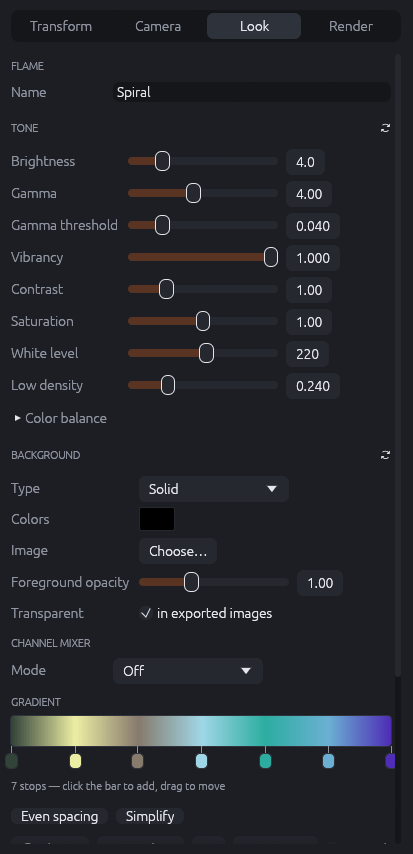
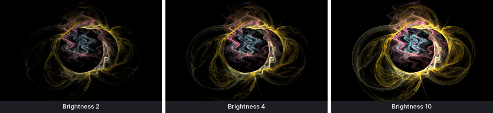
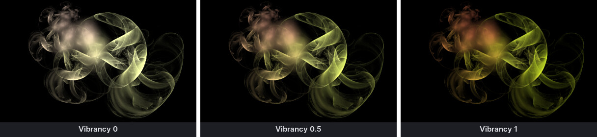
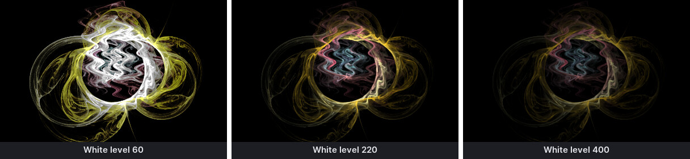
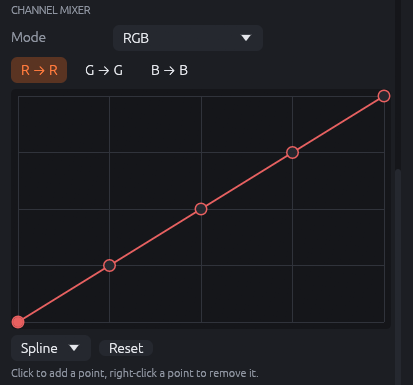
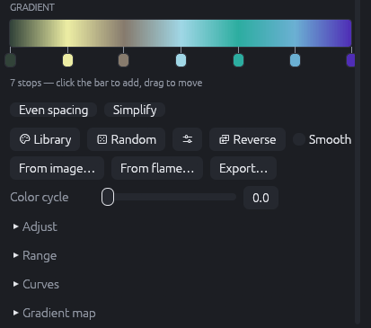
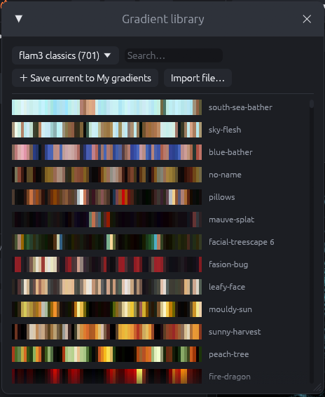
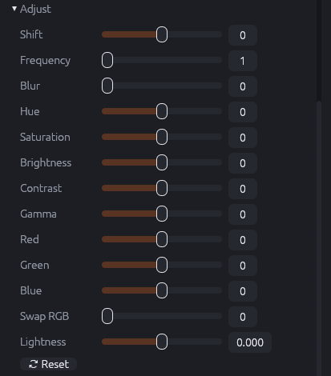
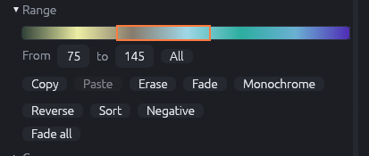
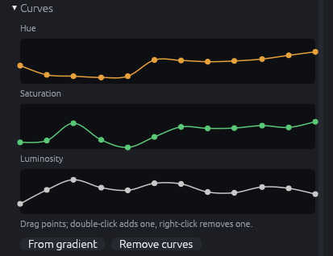

# Look: tone, background and gradient

The **Look** tab holds everything that decides how the flame's hits become colors: the tone
mapping, the background, the channel mixer and the gradient with its tools.

{: .half}

## Flame name

**Name** is saved in the flame file and shown in the title bar when the flame has no file yet.
Exported images suggest it as their file name.

## Tone

The tone settings turn the hit counts of the chaos game into brightness (chapter "How fractal
flames work" explains why a logarithm is needed). They work on the whole image and cost
nothing to change: the preview updates without restarting the chaos game.

| Setting | Range | Effect |
|---------|-------|--------|
| **Brightness** | 0–20 | Scales the whole image. Raise it when the flame is too dark overall. |
| **Gamma** | 1–8 | Lifts faint parts relative to bright ones. Higher values reveal veils and fine structure, but also grain; lower values give more contrast and deep blacks. |
| **Gamma threshold** | 0–0.2 | Below this density, gamma is applied linearly. Raise it if gamma amplifies grain in sparse areas. |
| **Vibrancy** | 0–1 | 1: gamma works on the brightness only and colors stay saturated. 0: gamma works on each color channel, so bright areas wash out towards white. |
| **Contrast** | 0.1–4 | Spreads or compresses the brightness range around the middle. |
| **Saturation** | 0–2 | 0 is grayscale, 1 unchanged, 2 very colorful. |
| **White level** | 20–400 | The density at which colors reach full intensity and start to clip. Lower values brighten and burn out dense areas; higher values keep detail in bright areas. |
| **Low density** | 0–1 | The brightness of very sparse areas (JWildfire's "low density brightness"). Higher values make faint outer parts more visible. |

**Color balance** (collapsed) multiplies the red, green and blue channels (0–2 each), to warm
up or cool down the whole image.

The ↻ button next to *Tone* resets all tone settings to the defaults.

## Background

- **Type**: *Solid* (one color), *4 corners* (a gradient between four corner colors) or
  *4 corners + center* (with a fifth color in the middle).
- **Colors**: click a swatch to pick its color.
- **Image**: an image shown behind the flame instead of the colors, stretched to the image
  size. **×** removes it; "not found" means the file cannot be loaded (the colors are used
  then).
- **Foreground opacity** (0–3): how much the flame covers the background in transparent
  images. 1 is normal; less makes the flame see-through, more makes faint parts more opaque.
- **Transparent** – *in exported images*: PNG exports get a transparent background instead of
  the background color. The flame's brightness becomes its opacity, so the image can be put
  over other pictures.

Background transforms (transforms panel) draw patterns on top of this background.

## Channel mixer

{: .half}

The channel mixer applies curves to the finished colors (JWildfire 7). **Mode**:

- *Off*.
- *Brightness*: one curve that maps input brightness to output brightness, like a tone curve in
  a photo editor. An S-curve increases contrast; lifting the left end brightens shadows.
- *RGB*: three curves, red → red, green → green, blue → blue. Pick a curve with the tabs
  above the graph. Lowering the blue curve's middle gives warmer midtones, and so on.
- *Full*: nine curves: each output channel can take any input channel (red → green, …), for
  strong color effects.

Click the graph to add a point, drag points, right-click a point to remove it. The menu below
the graph chooses the interpolation (Spline, Bezier, Linear); **Reset** returns the curve to
a straight line.

## Gradient

{: .half}

The gradient is the strip of 256 colors that the color index of the points refers to (chapter
"How fractal flames work"). Each layer has its own gradient.

### Editing stops

RWildFire describes the gradient by **stops**, the small squares below the strip: colors at
positions between which the gradient blends.

- **Click the strip** to add a stop with the color at that place.
- **Drag** a stop to move it. Click a stop to select it: a color swatch and **Remove** appear
  below the strip. Click the swatch to change the stop's color; **Remove** deletes the stop.
- **Even spacing** spreads the stops evenly.
- **Simplify** removes stops that are not needed for the look (useful after importing a
  gradient with 256 individual colors).

### Gradient buttons

- **Library** opens the gradient library (below).
- **Random** makes a random gradient with the settings of the sliders menu next to it:
  - *RWildFire* (default): a few harmonic hues.
  - One of JWildfire's generators (Bold, Monochrome, Smooth, Stripes, Strong hue, Two colors,
    Uneven curves, Uniform curves), with the number of **key colors**, **Fade between the
    colors** (off: hard bands) and **Uniform spacing**.
  - **Similar to this gradient** clusters the colors of the current gradient and builds a new
    one from them: same mood, different arrangement.
- **Reverse** turns the gradient around.
- **Smooth**: when a point's color index falls between two of the 256 gradient entries, the
  renderer blends the two instead of taking the nearer one. This removes faint banding in
  smooth color transitions.
- **From image…** takes the 256 colors that represent an image best (median cut), sorted by
  hue. A photo of a sunset gives a sunset gradient.
- **From flame…** takes the gradient of another flame file.
- **Export…** saves the gradient as `.map` (Fractint, JWildfire) or `.ugr` (Ultra Fractal).
- **Color cycle** (0–256) moves the colors along the gradient while rendering, without
  changing the gradient: 256 is one full turn. Keyed on the timeline, it cycles the colors in
  animations; fractional values blend neighbouring colors.

### Gradient library

{: .half}

The library holds about 1600 gradients in groups (flam3 classics, Floral, Sky, Universe,
Stars, Carr) and your own gradients (**My gradients**). Choose a group in the menu, type in
**Search…** to filter by name, and click a gradient to apply it.

- **Save current to My gradients** stores the current gradient in your gradients folder.
- **Import file…** loads `.ugr`, `.map` or flam3 palette files into My gradients.

### Adjust

{: .half}

The **Adjust** sliders change the whole gradient relative to the state when you opened them:

| Slider | Effect |
|--------|--------|
| Shift | Moves the colors along the gradient (wrapping around). |
| Frequency | Repeats the gradient 1–16 times. |
| Blur | Averages neighbouring colors. |
| Hue | Turns all hues around the color wheel. |
| Saturation, Brightness, Contrast | As in a photo editor. |
| Gamma | Brightens or darkens the midtones. |
| Red, Green, Blue | Add to or remove from one channel. |
| Swap RGB | Swaps color channels (RBG, GRB, GBR, BRG, BGR across the range of the slider). |
| Lightness | Changes the lightness in HSL. |

**Reset** returns to the gradient before the adjustments.

### Range

{: .half}

The range tools work on a part of the gradient. Drag on the strip to select a range (orange
frame), or type **From** and **to** (0–255); **All** selects everything.

- **Copy** / **Paste**: copies the range and pastes it at the start of another range.
- **Erase** makes the range black.
- **Fade** replaces the range with a straight transition between its first and last color.
- **Monochrome** gives the whole range one hue (the average).
- **Reverse**, **Sort** (by hue, then brightness), **Negative**.
- **Fade all** fills black gaps in the whole gradient with transitions between the colors
  around them, e.g. after Erase.

### Curves

{: .half}

The curves describe the gradient by three curves along its length: **Hue**, **Saturation** and
**Luminosity**. **Start from the gradient** (or **From gradient**) creates curves that pass
through the current colors; then drag points to reshape the gradient smoothly. Double-click
adds a point, right-click removes one. **Remove curves** keeps the gradient but forgets the
curves.

### Gradient map

A gradient map (JWildfire) takes colors from an image instead of the gradient: the point's
position picks a pixel. It is used by transforms with Diffusion or Cyclic coloring.

- **Image**: the image used as a two-dimensional gradient; **×** removes it.
- **Horiz. scale / offset**, **Vert. scale / offset**: how a point's x and y move across the
  image (it is mirrored at the edges).
- **Color shift**, **Color scale**: how much the point's color index moves and scales the
  position in the image.
