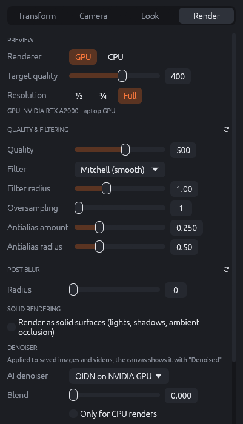
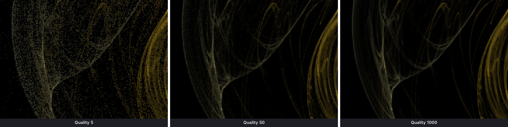
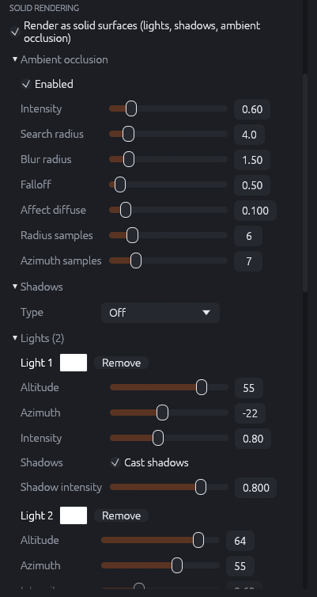
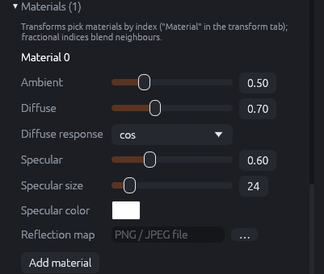
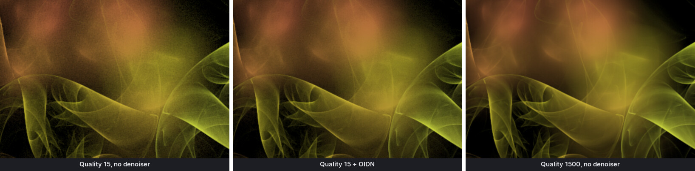
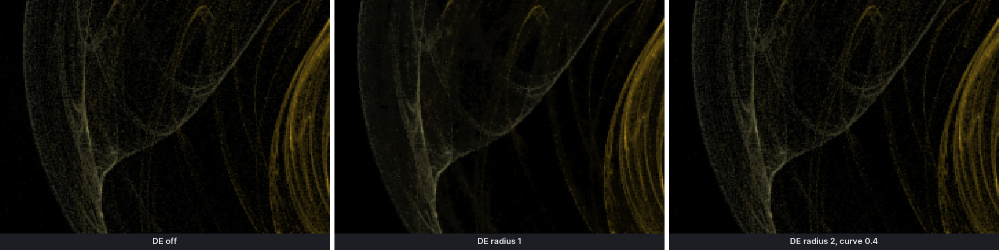
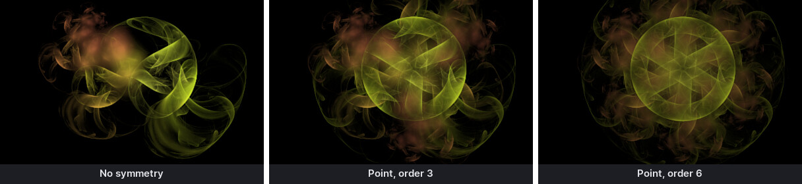
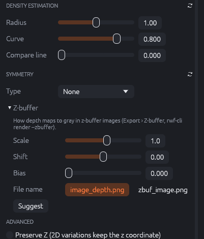

# Render settings

The **Render** tab of the inspector holds the settings that decide how cleanly and in which
style the flame is rendered: the preview, quality and filtering, post blur, solid rendering,
the AI denoiser, density estimation, post symmetry and the z-buffer. Except for the preview
settings, they are saved with the flame and used by every render: the canvas, exports, the
batch renderer and the command line.

{: .half}

## Preview

These settings only affect the canvas and are not saved in the flame.

- **Renderer**: *GPU* (fast, the default when a suitable graphics card is found) or *CPU* (the
  exact reference renderer). The CPU is useful to check effects that the GPU does not render,
  such as color modulation.
- **Target quality**: the quality at which the preview stops refining (logarithmic, 10–5000).
  Higher values give a cleaner preview but take longer and use the GPU continuously. The
  default comes from the preferences.
- **Resolution**: renders the preview at ½, ¾ or full canvas resolution. Lower resolutions
  refine much faster on slow GPUs and with heavy flames.
- Below: the name of the GPU in use.

## Quality and filtering

- **Quality** (10–10000, logarithmic): the number of points per pixel for final renders. The
  noise falls with the square root of the quality, so 4× the quality halves the grain and takes
  4× as long. Typical values: 200–500 for a quick look, 1000–3000 for final images, more for
  very sparse or very dark flames.

- **Filter**: the shape of the spatial filter that spreads each point over neighbouring
  pixels. *Gaussian* and *Mitchell (smooth)* are soft and safe; *Lanczos* and *Mitchell* are
  sharper; *Box* does not blend at all. *Mitchell / sine pow (adaptive)* chooses per pixel: a
  sharp kernel in detailed areas, a soft one in smooth areas and a wide one in sparse areas.
- **Filter radius** (0–3): the size of the filter. Larger values give softer, smoother images;
  0 turns spatial filtering off (sharpest, but grainier).
- With the adaptive filter: **Sharpness** is the edge threshold below which the soft kernel is
  used; **Low density** the intensity below which the wide kernel is used; **Indicator** shows
  which kernel was chosen (red: detail, green: soft, blue: low density) to tune the two.
- **Oversampling** (1–4): renders internally at a higher resolution and scales down. Removes
  jagged edges on thin lines; costs memory and time (2 is four times the pixels).
- **Antialias amount** and **Antialias radius** (JWildfire): move a share of the points
  by a small random distance (larger with a larger radius) before they are drawn. This softens hard-edged
  structures without blurring the whole image.

The ↻ button resets the filter settings (the quality is kept).

## Post blur

- **Radius** (0–16): spreads every point over a radial kernel of this many pixels, for a soft,
  glowing look. 0 is off.
- **Fade**: the share of the points that stay unblurred, so sharp structure remains visible in
  the glow.
- **Falloff**: how quickly the kernel gets darker towards its edge.

## Solid rendering

Solid rendering (JWildfire 6) renders 3D flames as lit surfaces. Points become small surface
elements whose orientation is estimated from their neighbours; then lights, shadows and
ambient occlusion are calculated. Switch it on with **Render as solid surfaces**. It works best
with dense 3D flames, e.g. from the *Solid* random generators.

{: .half}

**Ambient occlusion** darkens creases and cavities that receive less light from their
surroundings:

| Setting | Effect |
|---------|--------|
| Enabled | Switches ambient occlusion on. |
| Intensity | How dark occluded areas get. |
| Search radius | How far around each point is searched for occluders (larger: broader shading). |
| Blur radius | Smooths the occlusion. |
| Falloff | How quickly the influence of distant occluders decreases. |
| Affect diffuse | How much occlusion also darkens the directly lit (diffuse) light. |
| Radius samples, Azimuth samples | How many directions are tested (more: smoother, slower). |

**Shadows**: *Off*, *Fast* or *Smooth* shadows from the lights that cast shadows. **Map size**
is the resolution of the shadow maps, **Bias** shifts the shadow test to avoid "shadow acne"
(dark speckles on lit surfaces), **Smoothness** softens the shadow edges.

**Lights**: each light has a color, an **Altitude** (height above the horizon, 90° = from
above), an **Azimuth** (direction around the flame), an **Intensity**, and **Cast shadows**
with a **Shadow intensity**. **Add light** and **Remove** change the number of lights.

{: .half}

**Materials**: transforms pick a material by index (Transform tab › Solid material). Each
material has:

- **Ambient**: light that reaches the surface from everywhere.
- **Diffuse** and **Diffuse response** (cos, cos², …): matt reflection of the lights and how
  it falls off with the angle.
- **Specular**, **Specular size**, **Specular color**: glossy highlights; a larger size gives
  smaller, sharper highlights.
- **Reflection map**: an image (PNG/JPEG) reflected by the surface, with its **Reflection**
  intensity, for metallic or glassy looks.

**Depth of field bokeh** (solid only): **Kernel**, **Intensity**, **Brightness**, **Size** and
**Activation** of the bokeh highlights that the solid renderer's depth of field produces.

## Denoiser

The AI denoiser removes the grain that remains after rendering, using Intel® Open Image
Denoise (OIDN), a small neural network that runs locally. It is applied to **saved** images
and videos; the canvas shows it only with **Denoised** in the canvas toolbar.

- **AI denoiser**: *Off*, *OIDN* (on the CPU) or *OIDN on NVIDIA GPU* (much faster; falls back
  to the CPU when no NVIDIA GPU is available).
- **Blend** (0–1): mixes the original image back in. 0 is fully denoised; 0.2–0.4 keeps some
  natural grain and fine detail.
- **Only for CPU renders**: apply the denoiser only to CPU renders (JWildfire's default, because
  JWildfire's GPU renderer was separate).
- The line below says which denoiser is used, or why it is not available.

The denoiser works on the image **before** spatial filtering and density estimation. The filter
spreads every point over a few pixels and would turn the grain into small blobs, which the
denoiser takes for detail and keeps; independent pixel noise is what it removes best. So the
filter settings stay as they are and the denoiser still gets clean input. When rendering on
the GPU, RWildFire also gives OIDN helper images (the colors without lighting, and for solid
flames the surface normals), which helps it keep edges. **Blend** mixes the normal, filtered
render back in.

The denoiser smooths very fine structures a little. For flames with hair-thin detail, a
higher quality without denoiser, or a Blend of 0.3, often looks best.

## Density estimation

Density estimation (DE) smooths sparse areas, where few points land and the image would be
grainy, more strongly than dense areas, where the detail is.

- **Radius** (0–2): the maximum blur radius in sparse areas. 0 turns DE off.
- **Curve** (0–1): how quickly the blur shrinks as the density grows. Higher values blur a
  wider range of densities (stronger effect, but more blur).
- **Compare line** (0–1): shows the image with DE on one side of a vertical line and without on
  the other, at this position. Handy to judge the effect; set it back to 0 afterwards.

## Symmetry

Post symmetry copies every point before it is drawn, so the image becomes symmetric without
changing the transforms.

- **Type**: *None*, *Point* (rotational symmetry), *X axis* or *Y axis* (mirror symmetry).
- **Order** (point symmetry): the number of copies around the center (3: threefold).
- **Center X / Y**: the center of the symmetry.
- **Distance**, **Rotation** (mirror symmetry): the offset and angle of the mirror copy.

## Z-buffer

{: .half}

A z-buffer image is a 16-bit grayscale PNG whose brightness is the depth of the flame at each
pixel. Compositing and 3D programs use it for depth effects. It is written next to the image
when **Z-buffer** is ticked in the export dialog (or with `rwf-cli render --zbuffer`).

- **Scale**: how depth maps to gray (negative: black near the camera).
- **Shift**: moves the gray range.
- **Bias**: the gray level of the empty background.
- **File name**: `image_depth.png` or `zbuf_image.png` (JWildfire's two naming styles).
- **Suggest** renders the depth quickly and fits Scale and Shift to the depth range of the
  flame.

## Advanced

**Preserve Z**: 2D variations normally set the point's depth to 0. With Preserve Z they keep
the z coordinate, so 3D structure built by earlier transforms survives. Needed by some
JWildfire flames.
