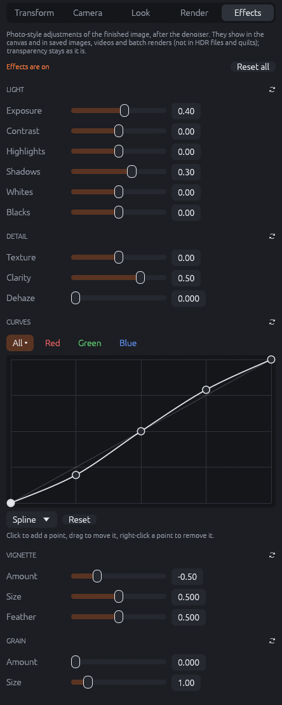
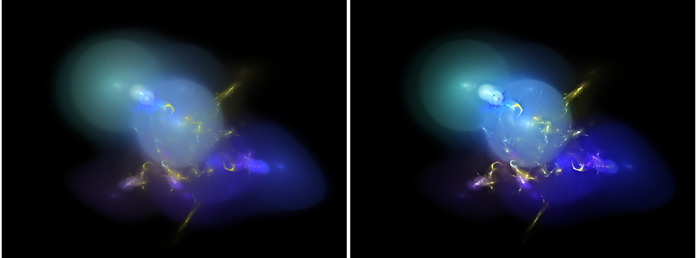

# Image effects

The **Effects** tab of the inspector adjusts the finished image the way a photo editor would:
exposure and contrast, bright and dark areas, local contrast, haze, tone curves, a vignette
and film grain. The effects work on the image after tone mapping and after the denoiser, so
they change nothing in how the flame is rendered; they are quick to try and are saved with the
flame.

{: .half}

The effects show in the canvas (also with **Denoised**), in the render workspace and in every
saved image, video, batch, movie and dance render. They are not applied to HDR files (saved as
rendered, like the denoiser) and to quilts (they work on the whole image; tiles would get
seams). Transparency stays as it is: the effects change the colors, not the alpha channel.

Blur sizes and the grain scale with the image height, so the small canvas preview looks like
the full size render. The line at the top says whether any effect is set; **Reset all** sets
every effect back to neutral, and each section has its own reset button.

## Light

- **Exposure** (−3 to 3): brightens or darkens the image in photographic stops; +1 doubles the
  light. Unlike **Brightness** on the Look tab, it does not change the tone mapping of the
  render, only the finished image.
- **Contrast** (−1 to 1): an S-curve around the middle gray. Positive values darken the
  shadows and brighten the highlights, negative values make the image flatter. Black and white
  stay where they are. The **Contrast** of the Look tab changes the tone mapping instead.
- **Highlights** and **Shadows** (−1 to 1): brighten (positive) or darken (negative) only the
  bright or only the dark areas. The areas are found on a blurred copy of the image, so fine
  detail is not cut apart. Negative highlights bring back detail in bright glows; positive
  shadows bring out faint structures.
- **Whites** (−1 to 1): moves the white point. Positive values make the highlights brighter
  (they clip sooner), negative values compress them, so nothing is pure white. **White level**
  on the Look tab works before the gamma curve instead.
- **Blacks** (−1 to 1): moves the black point. Positive values lift the blacks to a dark gray,
  negative values deepen them (dark detail turns black).

## Detail

- **Texture** (−1 to 1): local contrast of fine detail, a few pixels in size. Positive values
  make lines and structures crisper, negative values softer.
- **Clarity** (−1 to 1): local contrast of larger structures, mostly in the midtones. Positive
  values give more depth and punch, negative values a soft, dreamy look.
- **Dehaze** (0 to 1): removes haze and milky glow. It subtracts the local minimum of the
  color channels and stretches the rest, which is strongest in bright, washed-out areas. On
  flames with a black background it mostly deepens the contrast.

## Curves

Tone curves for **All** channels and for **Red**, **Green** and **Blue** (applied after the
curve of all channels). The x axis is the brightness before, the y axis after; the diagonal
changes nothing. Click to add a point, drag a point to move it, right-click a point to remove
it. The interpolation (*Spline*, *Bezier*, *Linear*) sets how the curve runs between the
points; **Reset** makes the curve straight again. A dot after a channel name marks a changed
curve.

## Vignette

- **Amount** (−1 to 1): darkens (negative) or lightens (positive) the edges and corners.
- **Size** (0 to 1): where the vignette starts, from the center (0) to only the corners (1).
- **Feather** (0 to 1): how soft the transition is, from a hard edge (0) to a gradual fade (1).

## Grain

- **Amount** (0 to 1): adds film grain, strongest in the midtones. The grain is reproducible:
  the same image always gets the same grain, also in every frame of an animation.
- **Size** (0.5 to 4): 1 is one pixel at an image height of 1000 pixels; the grain grows with
  the image, so the preview shows it as the final render.

## Order

The effects run in a fixed order: dehaze, exposure, contrast, highlights and shadows, texture
and clarity, whites and blacks, curves, vignette, grain. Saved images are computed on the CPU;
the canvas uses the GPU with the same calculation (the results differ by at most one step of
255). Scripts set the effects with the `effects_…` fields of a flame (see Scripting).
