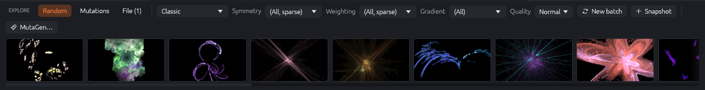
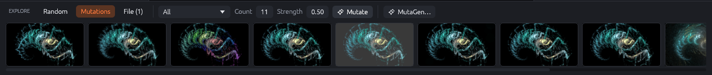
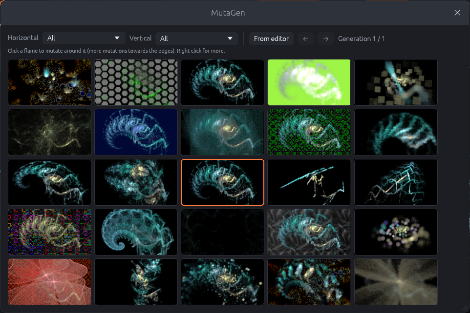
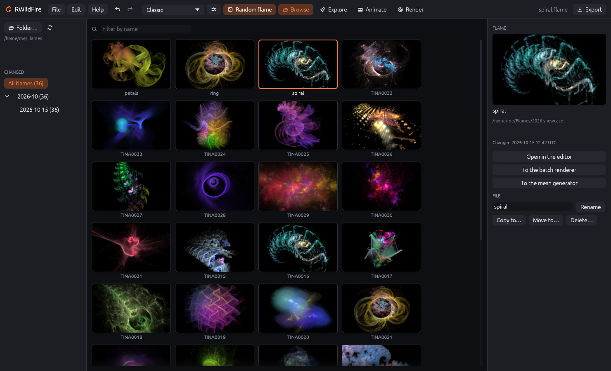

# Making flames: random generators, Explore, MutaGen and the browser

Few flames are built from scratch. Most start as a random flame or a mutation of another
flame, and are then refined in the editor. RWildFire offers four tools for this: the random
flame generators, the Explore strip, MutaGen and the flame browser.

## Random flames

**Random flame** in the top bar (or <kbd>Space</kbd>) replaces the editor's flame with a new
flame from the generator chosen in the menu next to it. The previous flame stays one undo step
away, so you can step back with <kbd>Ctrl</kbd>+<kbd>Z</kbd> when you liked it better.

### Generators

RWildFire contains JWildfire's random flame generators plus two of its own:

- **Classic** (RWildFire): a few transforms with popular variations, framed automatically. A
  good, fast all-rounder; it is used for the flame at program start.
- **Symmetric** (RWildFire): one to three transforms with point symmetry of order 3 to 10:
  mandala-like flames.
- **(All)** picks one of the generators at random for every flame.

JWildfire's generators each produce a typical style:

| Group | Generators |
|-------|------------|
| Classic 2D styles | Brokat, Bubbles, Cross, Duality, EDisc, Galaxies, Ghosts, Gnarl, Gnarl (experimental), JulianDisc, JulianRings, Julians, Linear only, Machine, Mandelbrot, Orchids, Outlines, Phoenix, Raster, Rays, Sierpinsky, Simple (stunning), Simple (experimental), Simple tiling, Spherical, Spirals, Splits, Synth, Tentacle, Tile Ball, Underwater, Xenomorph |
| 3D | Affine3D, Brokat3D, Bubbles3D, Bubbles3D (experimental), Flowers3D (filled), Flowers3D (stunning), Gnarl3D, Spherical3D, Spirals3D |
| Solid (lit 3D surfaces) | Solid (experimental), Solid (recursive), Solid (shadows), Solid (stunning), Solid Julia3D, Solid Labyrinth |
| Special looks | Black&White (monochrome), Bokeh (bokeh effects), Flame with Background (background transforms), Layers (several layers), Painterly (brush strokes), SubFlame (embedded flames), Duckies |

Generators marked "experimental" are JWildfire's wilder variants: more surprises, more misses.
3D and solid flames show their depth best when you turn the camera (Camera tab).

Most generators render a few small test images for each flame and keep the first one that
fills enough of the frame, so that empty or tiny flames are rare. While this runs, the button
reads "Generating…" and the editor stays usable.

### Random extras

The sliders button next to the generator menu adds extras to every random flame:

{: .half}

- **Symmetry**: *None*; *(All)* adds a random post symmetry (point, X axis or Y axis);
  *(All, sparse)* does so for about a third of the flames; or always *XAxis*, *YAxis* or
  *Point* symmetry with random center and order.
- **Weighting field**: *None*; *(All)* or *(All, sparse)*; or always *Cellular noise*,
  *Basic noise*, *Fractal noise* or an *Image map* weighting field on the transforms.
- **Gradient**: the random gradient generator: *(All)* or one of Bold, Monochrome, Smooth,
  Stripes, Strong hue, Two colors, Uneven curves, Uniform curves.
- **Variations**: the variation profile: which variations the generators may use. *All
  variations*, or a profile you created in the preferences (e.g. "only my favourites" or
  "everything except the slow ones").

## The Explore strip

**Explore** in the top bar shows a strip below the canvas with batches of flames to choose
from. Click a thumbnail to load the flame into the editor (one undo step). The strip has three
modes:

### Random

A batch of random flames from the generator chosen in the strip, with its own **Symmetry**,
**Weighting** and **Gradient** extras.

- **Quality**: how hard each flame tries to fill the frame: *Low*, *Normal* or *High*. Higher
  finds fuller flames but takes longer.
- **New batch** starts a batch (24 flames by default; the size and whether a new batch
  replaces the strip, is inserted in front or appended are set in the preferences). While a
  batch is running, the button becomes **Cancel**; finished thumbnails stay.
- **Snapshot** puts a copy of the editor's flame in front of the strip, e.g. to keep a
  favourite while you continue exploring.

### Mutations

Quick variants of the editor's flame:

- The menu chooses the **mutation type** (see the table below); *All* mixes them.
- **Count**: mutations per click.
- **Strength** (0–1): how far the mutations go. Small values give close relatives, large
  values wild departures.
- **Mutate** creates the mutations. Each mutation is checked like a random flame (it must fill
  the frame and differ visibly from the original).

Clicking a mutation loads it into the editor; clicking **Mutate** again then mutates *that*
flame. This way you can walk step by step towards a flame you like.

| Mutation | What changes |
|----------|--------------|
| Add transform | A new transform with a random variation. |
| Add variation | A random variation is added to a transform. |
| Affine | The affine of a transform is moved, turned or scaled. |
| Affine 3D | A 3D rotation of a transform's affine. |
| Bokeh | Depth of field with a random bokeh shape. |
| Change weight | The weight of a transform. |
| Color type | The coloring mode of transforms. |
| Gradient position | The color positions of the transforms. |
| Local gamma | Random color modulation (gamma, contrast, saturation, hue) on all transforms. |
| Painterly style | Brush strokes and painterly settings. |
| Random background / Random background color | A background pattern or color. |
| Random flame | Replaces the layer (transforms and gradient) by that of a random flame; camera and render settings stay. |
| Random gradient / Similar gradient | A new gradient, or one built from the current colors. |
| Random parameter | One variation parameter. |
| Random Z transform | Adds depth (z) to a transform. |
| Weighting field | Adds or changes a weighting field. |

### File

When a file with several flames is opened (or several flames are pasted, or a script creates
flames), **File** shows them. **Load thumbnails** renders thumbnails of up to 64 of them. Click a
flame to edit it; **Save** then writes it back into its place in the file and keeps the others.

### MutaGen

**MutaGen…** (in the Explore strip) opens JWildfire's mutation grid: a 5×5 grid with the
current flame in the center and mutations around it. The farther a cell is from the center,
the more mutations it gets: cells to the left and right get the **Horizontal** mutation type,
cells above and below the **Vertical** one, corner cells both.

- **Click** a flame to make it the new center: a new generation is mutated around it.
- **Right-click** a flame for *Open in editor* and *Mutate around this flame*.
- The **arrows** step through the generations, so you can go back to an earlier center.
- **From editor** starts over with the editor's flame.

Choosing two different mutation types (e.g. Affine horizontally, Random gradient vertically)
lets you steer shape and color independently.

## The flame browser

**Browse** in the top bar replaces the editor with a browser that shows all `.flame` files of a
folder and its sub-folders as thumbnails.

- **Folder…** chooses the folder (remembered between sessions); ↻ scans it again. You can
  also drop a folder onto the window.
- The list on the left groups the files by the date they were last changed: all flames, by
  month, by day. Click a group to see only its flames.
- **Filter by name** shows only files whose name contains the text.
- Click a thumbnail to select it. The panel on the right shows a larger preview, the path and
  the date, and the actions:
  - **Open in the editor** (also double-click or <kbd>Enter</kbd>). Files with several flames
    open all of them (Explore › File).
  - **To the batch renderer** adds the flames of the file to the batch queue.
  - **To the mesh generator** uses the flame in the mesh generator.
  - **Rename**, **Copy to…**, **Move to…** and **Delete…** (also <kbd>Delete</kbd>; asks first)
    manage the file.
- Arrow keys move the selection.

Thumbnails are rendered on the GPU in the background and cached while the browser is open.
Close the browser with **Browse** in the top bar.
