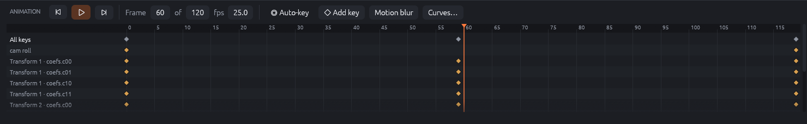
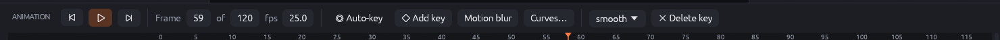
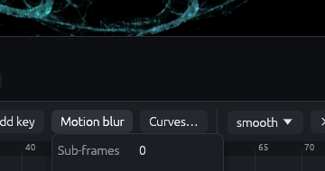
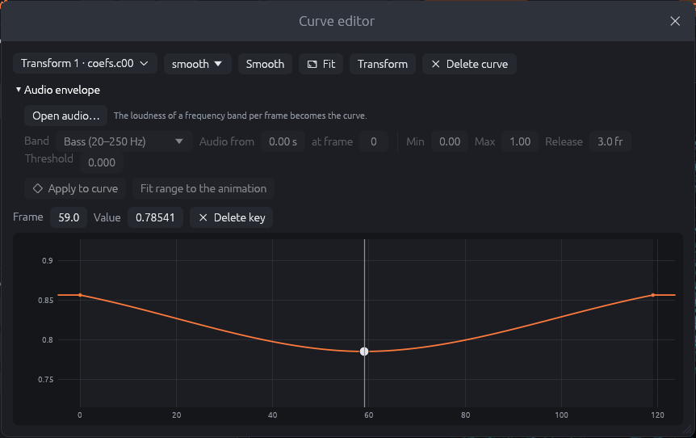

# Animation

Almost every number of a flame can change over time: camera, tone, transforms, variation
amounts and parameters, the color cycle, weighting fields, solid lights. RWildFire animates
them with **keyframes**: you set values at some frames, and RWildFire interpolates between
them. The animation is saved in the flame file. JWildfire's motion curves are imported as
keyframes.

## The timeline

**Animate** in the top bar shows the timeline below the canvas.

### Transport

- **⏮ / ▶ / ⏭**: first frame, play/pause (<kbd>Space</kbd> while the timeline is open), last
  frame. During playback the preview shows each frame as far as it gets before the next one.
- **Frame … of …**: the current frame and the length of the animation in frames. Frames are
  numbered from 0, so an animation of 120 frames runs from 0 to 119.
- **fps**: frames per second of the exported video. 25 or 30 is usual; with 120 frames at
  25 fps the animation lasts 4.8 seconds.

### Lanes

The lanes show one row per animated property (a *track*), with its keyframes as diamonds, and
an *All keys* row on top. The orange line is the playhead.

- **Click or drag** in the lanes or on the ruler to move the playhead (scrub). The editor shows
  the flame at that frame.
- **Click a diamond** to select the key and jump to its frame. The toolbar then offers the
  track's **interpolation** and **Delete key**:

- **Double-click a track name** to open it in the curve editor.

### Creating keys

There are two ways:

- **Auto-key** (red when on): every change you make in the editor creates or updates a key at
  the current frame for each property you change. Move the playhead, change something, move
  the playhead again, change something else: that is all it takes.
- **Add key** sets keys for a group of properties at the current frame, without changing
  them: *Camera*, *Selected transform* or *Tone (brightness, gamma, …)*. Use it to "pin" a
  state before you change things at another frame.

A typical workflow: go to frame 0 and choose **Add key › Camera**; go to the last frame, turn on
Auto-key and turn the camera. The camera now turns over the whole animation.

### Interpolation

How a track moves between its keys:

| Interpolation | Movement |
|---------------|----------|
| smooth | A smooth curve through all keys (the default): gentle acceleration and braking. |
| linear | Straight lines: constant speed between keys, abrupt changes at keys. |
| hold | Keeps each value until the next key: jumps. |
| spline | JWildfire's spline, as in imported JWildfire motion curves. |
| bezier | JWildfire's Bezier curve: passes near, not through, the inner keys. |

### Motion blur

{: .third}

**Motion blur** renders each frame of an exported animation as several sub-frames at slightly
different times and blends them, so fast movements leave trails, as in a film camera.

- **Sub-frames**: how many (0 is off). Rendering time grows accordingly.
- **Time step**: the time between the sub-frames, in frames. Larger values give longer trails.
- **Decay**: how quickly older sub-frames fade.

Motion blur is applied when exporting animations, not on the canvas.

## The curve editor

**Curves…** in the timeline (or a double-click on a track name) opens the curve editor, which
shows a track as a graph of value over frame.

- The first menu chooses the **property**; it can also create a curve for a property that is
  not animated yet (type to filter the long list).
- The second menu is the **interpolation**.
- **Smooth** averages every key with its neighbours: removes jitter, e.g. from audio curves.
- **Fit** shows all keys (also: double-click the graph background).
- **Transform**: **Scale** the values around their mean and add an **Offset**, then **Apply**.
  Makes a movement stronger or weaker without moving every key.
- **Delete curve** removes the whole track.

In the graph:

| Action | Result |
|--------|--------|
| Double-click | Adds a key. |
| Drag a key | Moves it in time and value. |
| Right-click a key | Deletes it. |
| Click a key | Selects it: **Frame** and **Value** fields appear above the graph for exact input. |
| Mouse wheel | Zooms the time axis; with <kbd>Shift</kbd> the value axis. |
| Middle mouse button | Pans the graph. |

### Curves from music

The **Audio envelope** section turns the loudness of a frequency band of a music file into a
curve, so that a property follows the music:

1. **Open audio…** loads an MP3, WAV, FLAC or Ogg Vorbis file.
2. **Band** chooses the frequencies: *Level* (all frequencies), *Bass* (20–250 Hz, the beat),
   *Low mids*, *Mids*, *High mids* or *Treble* (6–20 kHz, cymbals and hi-hats).
3. **Audio from … s at frame …** aligns the music with the animation: which second of the
   music corresponds to which frame.
4. **Min** and **Max** map silence and the loudest moment to property values (e.g. a rotation
   of 0° to 30°).
5. **Release** (frames): how slowly the curve falls back after a peak. Short values follow
   every beat; long values give a smoother pulse.
6. **Threshold**: the share of the loudest frame that still counts as silence, to ignore quiet
   background sound.
7. **Apply to curve** replaces the keys of the curve with the envelope (the blue preview
   shows it beforehand).

**Fit range to the animation** sets the frame count to the length of the music. Export the
animation as MP4, MOV or WebM and add the music in a video editor, or use the dancing flames
workspace, which writes the music into the video.

## Exporting animations

Use **Export › Animation** (chapter "Exporting") to render the animation as a video or as a
sequence of PNG images. The movie maker and the dancing flames workspace (chapter "The render
workspace") offer other ways to animate: morphs between several flames and flames moved by
music in real time.
