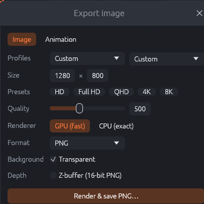
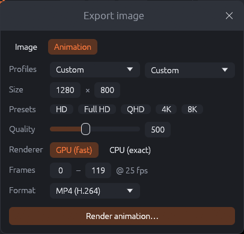

# Exporting images and animations

**Export** in the top bar (<kbd>Ctrl</kbd>+<kbd>E</kbd>) opens the export dialog. It renders the
editor's flame at any size and quality and saves it, without changing the flame. For very large
images, queues of flames, movies and long progressive renders, see chapter "The render
workspace".

## Images

{: .half}

- **Profiles**: two menus with the resolution and quality profiles from the preferences. Choosing
  a profile fills in size and quality. The flame remembers the profiles last chosen for it (if
  "Associate profiles with flames" is on in the preferences), so the next export starts with
  them.
- **Size**: width × height in pixels, up to 16384 per side. The flame is rendered with the same
  framing at any size: a larger size shows the same picture with more pixels.
- **Presets**: HD (1280), Full HD (1920), QHD (2560), 4K (3840) and 8K (7680) pixels wide; the
  height follows the flame's aspect ratio.
- **Quality**: points per pixel (50–20000). The render time grows linearly with quality *and*
  with the number of pixels: a 4K image at quality 2000 takes 16 times as long as a Full HD image
  at quality 500.
- **Renderer**: *GPU (fast)* or *CPU (exact)*. The CPU renders everything, including color
  modulation and the few CPU-only variations, but takes much longer.
- **Format**:
  - *PNG*: lossless, 8 bits per channel; can be transparent.
  - *JPEG*: smaller files; **JPEG quality** (50–100) sets the compression.
  - *HDR (Radiance)* and *OpenEXR*: 32-bit floating-point images with the raw, untonemapped
    brightness, for tonemapping and compositing programs. They are saved without the denoiser.
- **Background – Transparent** (PNG only): the background becomes transparent; the flame's
  brightness becomes its opacity.
- **Stereo 3D** (shown when stereo is set in the Camera tab): what will be saved, e.g. two eye
  images side by side, and the resulting image size.
- **Depth – Z-buffer (16-bit PNG)**: also saves a depth image next to the picture (see "Render
  settings › Z-buffer"; the hover text shows its file name).

**Render & save…** asks for the file name and renders. A progress bar shows the progress; the
status line then names the file, the time and whether and how the image was denoised.

## Animations

{: .half}

Switch to **Animation** to render the flame's animation (chapter "Animation"):

- **Frames**: the first and last frame to render, at the flame's frame rate.
- **Format**:
  - *PNG sequence*: one PNG per frame into a folder (always available).
  - *MP4 (H.264)*, *MOV (ProRes)*, *WebM (VP9)*: video files. They need ffmpeg in the `PATH`;
    without it these formats are disabled and the dialog says so.
  - *ANB (JWildfire)*: JWildfire's animation format.
- The dialog shows the number of motion blur sub-frames if motion blur is on.

**Render animation…** asks for the file (or folder for PNG frames) and renders frame by frame;
**Cancel** stops it. Size, quality and renderer are the same as for images; the quality applies
to each frame.

!!! tip
    For animations, a moderate quality (300–800) with the denoiser often looks better than a
    very high quality, because the eye does not notice small grain that changes from frame to
    frame, while the render time multiplies with every frame.
