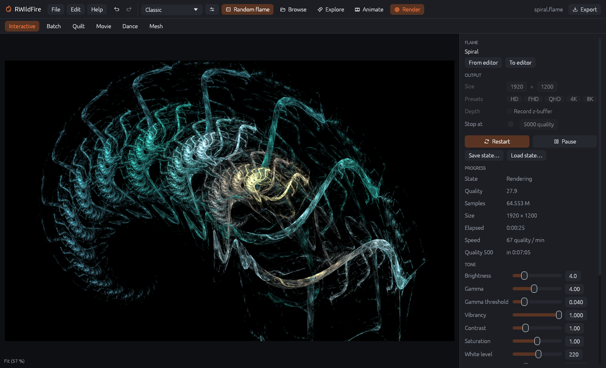
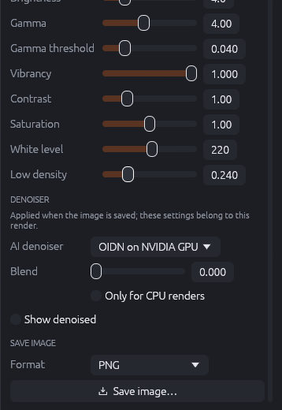
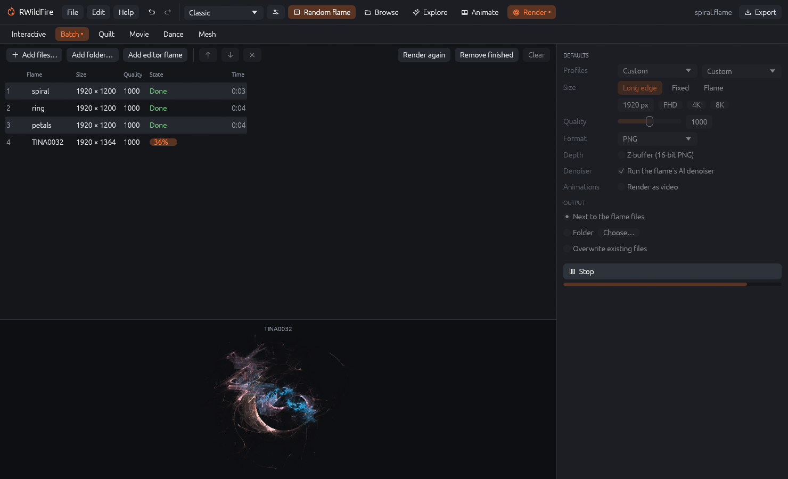
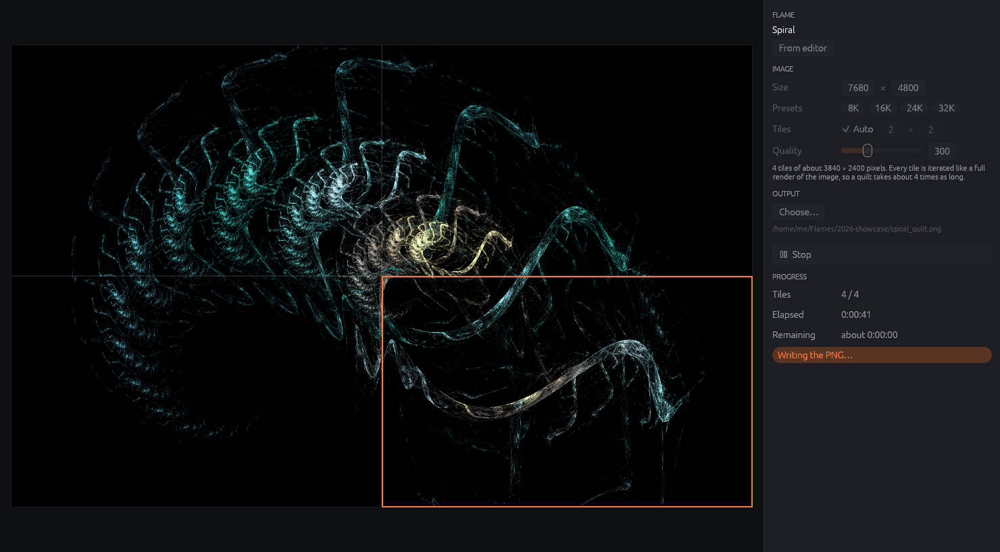
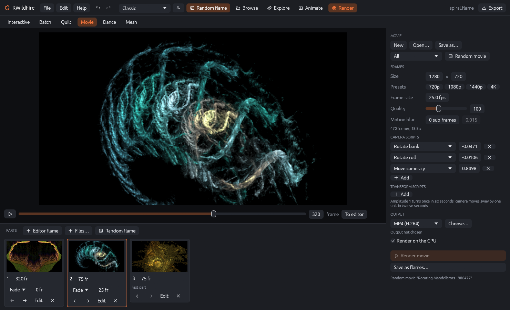
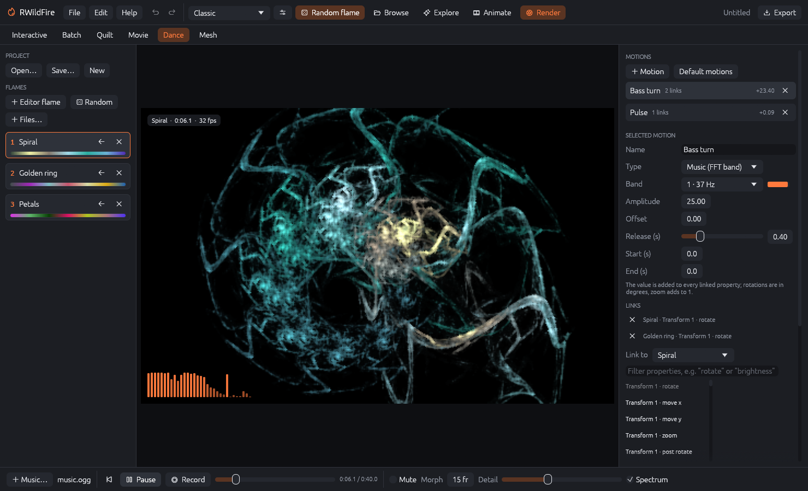
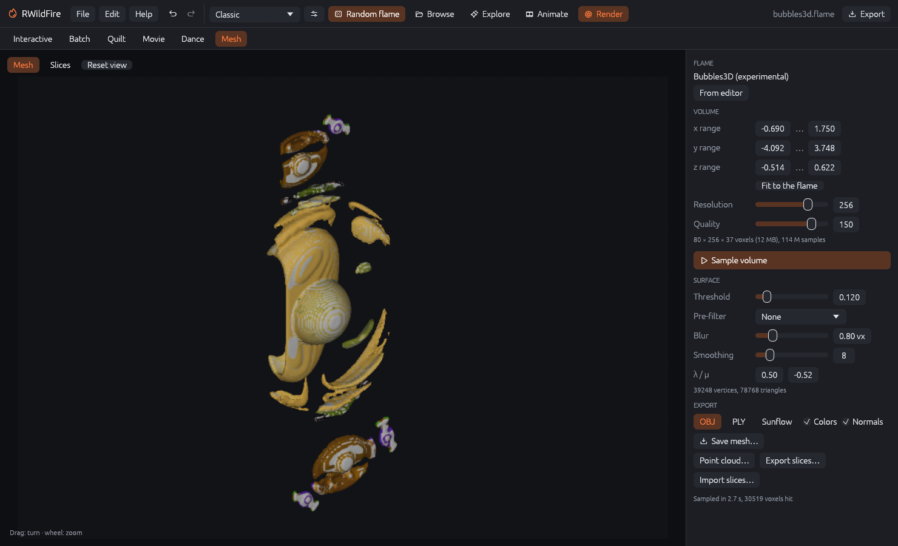
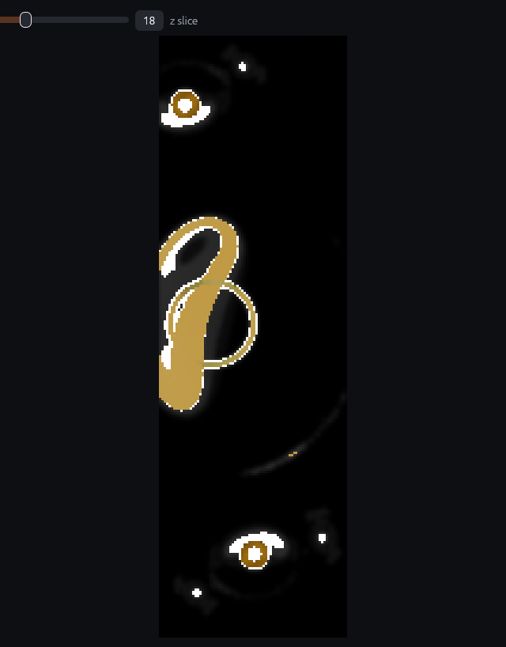

# The render workspace

**Render** in the top bar replaces the editor panels with the render workspace. It has six
tabs:

| Tab | Purpose |
|-----|---------|
| Interactive | Long, progressive renders of one flame: pause, resume, save the state and continue later. |
| Batch | A queue of flames rendered one after another into files. |
| Quilt | Very large images (up to gigapixels), rendered in tiles. |
| Movie | Movies from several flames that fade or morph into each other, with camera and transform motions. |
| Dance | Dancing flames: a pool of flames moved by music in real time, recorded into a video. |
| Mesh | 3D meshes (OBJ, PLY, Sunflow) and point clouds from 3D flames. |

The workspace keeps running in the background: you can return to the editor (click **Render**
again) while a batch, quilt, movie or mesh job works; a dot after "Render" and after the tab
name shows that a job is running. The Interactive, Batch and Quilt tabs need a GPU.

## Interactive renderer

The interactive renderer refines one image for as long as you let it. Unlike the export dialog,
it has no fixed end: you watch the image get cleaner and save it whenever it is good enough.

**Flame**: the flame's name. **From editor** takes the editor's current flame (the renderer
starts with it when opened); **To editor** loads the flame, with the tone settings you changed
here, back into the editor.

**Output**:

- **Size** and **Presets** (HD, FHD, QHD, 4K, 8K): the image size.
- **Depth – Record z-buffer**: also records the depth, so a z-buffer image can be saved.
- **Stop at … quality**: stops automatically at this quality (tick the box to enable).

**Start** begins the render (**Restart** starts over), **Pause** / **Resume** interrupt and
continue it. Size and depth can only be changed while no render is running.

**Save state…** writes the complete render state (the accumulated points, the flame and the
settings) into a `.rwfrender` file. **Load state…** loads it, and **Resume** continues exactly
where the render stopped, even after a restart of RWildFire. This way a render can run over
several evenings.

**Progress** shows the state, the reached quality, the number of points, size, elapsed time,
speed (quality per minute) and when the next quality mark will be reached (e.g. "Quality 500
in 0:07:05").

**Tone** and **Denoiser**: the tone settings (as in the Look tab) and the denoiser settings
(as in the Render tab) for this render. Changing them is instant: they only affect how the
accumulated points are shown, not the render itself. **Show denoised** shows the image as it
will be saved, refreshed every few seconds.

{: .third}

**Save image**: choose PNG, JPEG, HDR or OpenEXR and click **Save image…**. Saving does not
stop the render.

In the image: the mouse wheel zooms around the pointer, dragging pans, a double-click switches
between "fit" and 100 %. The zoom shown in the corner (e.g. "Fit (57 %)") is only the view; it
does not change the render. If you start a new render while the old one has run for a while
and was not saved, RWildFire asks before discarding it.

## Batch renderer

The batch renderer renders a queue of flames into image (or video) files, one after another,
on the GPU.

### The queue

- **Add files…**, **Add folder…** (all `.flame` files of a folder) and **Add editor flame**
  add jobs. Files with several flames add one job per flame. You can also drop flame files onto
  the window while the Batch tab is open, or send files from the flame browser.
- **↑ / ↓** move the selected job, **×** removes it.
- **Render again** queues finished and failed jobs once more; **Remove finished** clears done
  jobs; **Clear** removes all jobs.
- The table shows each job's flame, size, quality, state (Queued, a progress bar, Done,
  Skipped, Failed) and render time. The lower half shows the job being rendered.

### Defaults

The settings on the right apply to all jobs that have no own settings:

- **Profiles**: resolution and quality profiles from the preferences.
- **Size**:
  - *Long edge*: the longer side of the image gets this many pixels, the other follows the
    flame's aspect ratio (1920 px, FHD, 4K, 8K as quick choices). Good for mixed flames.
  - *Fixed*: every image gets exactly this width and height.
  - *Flame*: each flame's own size.
- **Quality**, **Format** (PNG, JPEG, HDR, OpenEXR) and **Depth** (z-buffer images).
- **Denoiser – Run the flame's AI denoiser**: applies each flame's denoiser settings. Untick it
  to save all images without denoising.
- **Animations – Render as video**: animated flames become videos (choose the **Video
  format**) instead of a still image of frame 0.
- **Output**: *Next to the flame files* (`name.png` beside `name.flame`) or a *Folder*. Flames
  added from the editor have no file, so they need an output folder. **Overwrite existing files**: when off, jobs whose
  output exists are skipped, so an interrupted batch can be restarted without rendering
  everything again.

**Render N jobs** starts the queue; **Stop** cancels the running job and leaves the rest of
the queue waiting.

### Per-job settings

Click a job to select it. Below the defaults, **Selected job** shows its file and lets you give
it its own **Size** and **Quality** (tick the box, then set the value), and shows where its
output will be written.

## Quilt renderer

The quilt renderer makes images larger than the GPU can render at once (a 30720 × 17280 poster
at full quality, for example). It splits the image into tiles, renders each tile like a full
image with the same framing, and stitches them seamlessly into one PNG.

- **From editor** takes the editor's flame.
- **Size** and **Presets** (8K, 16K, 24K, 32K wide): the final image size.
- **Tiles**: *Auto* chooses the grid; otherwise set columns × rows.
- **Quality**: as for a normal render. The hint below says how many tiles of which size will be
  rendered and how long that takes compared with a single render: every tile is iterated like
  a full render, so 12 tiles take about 12 times as long.
- **Output**: **Choose…** sets the PNG file (default: `<flame>_quilt.png` next to the flame).
- **Render quilt** starts; **Stop** cancels (finished tiles are kept, see below).

The finished tiles are kept in a folder next to the output (`<output>.quilt-tiles`). If you stop
and later start the same quilt again (same flame, size, grid and quality), the finished tiles
are reused and only the rest is rendered. The preview shows the tiles as they finish; the
progress shows the tiles done, elapsed and remaining time. The denoiser and the image effects
are not applied to quilts: they work on the whole image, and tiles would get seams.

## Movie maker

The movie maker (JWildfire's "Easy movie maker") builds a movie from several flames: each
flame is a **part** that is shown for some frames and then changes into the next one, while
camera and transform **scripts** keep everything in motion.

### Parts

The strip at the bottom shows the parts in order (the mouse wheel scrolls it sideways):

- **Editor flame**, **Files…** and **Random flame** (from the top bar's generator) add parts.
- Each part shows its length in frames (**fr**), the transition into the next part (**Fade**
  or **Morph**) and the length of the transition. The last part has no transition.
  - *Fade*: the next flame fades in while the current one fades out.
  - *Morph*: the transforms of the current flame change gradually into those of the next one.
    Works best between related flames, e.g. mutations of each other.
- **← / →** move a part, **Edit** opens its flame in the editor, **×** removes it. Click a part
  to jump to it.

### Movie settings

- **New**, **Open…** (also JWildfire `.jwfmovie` files) and **Save as…** manage movie projects.
- **Random movie** with the menu next to it (*All*, *Rotating Mandelbrots*, *Transforming
  Bubbles*, *Transforming Duckies*) replaces the movie with one of JWildfire's random movies.
- **Frames**: **Size** and **Presets** (720p, 1080p, 1440p, 4K), **Frame rate**, **Quality**,
  **Motion blur** sub-frames and their time step. The line below shows the total length.
- **Camera scripts**: continuous camera motions over the whole movie: *Rotate pitch / roll /
  yaw / bank*, *Move camera x / y / z*, each with an amplitude. Amplitude 1 turns once in six
  seconds; camera moves sway by one unit in twelve seconds. Negative amplitudes go the other way.
- **Transform scripts**: rotate all transforms, the first to fifth, the last, the final or the
  background transform, or their post affines, with an amplitude.
- **Add** adds a script; **×** removes it.

### Preview and output

The preview shows the frame at the slider; **▶** plays it as fast as it renders; **To editor**
opens the shown frame in the editor.

**Output**: choose MP4, MOV, WebM, PNG sequence or ANB and **Choose…** the file or folder.
**Render on the GPU** is much faster; untick it for the exact CPU renderer. **Render movie**
renders all frames (with elapsed and remaining time); **Save as flames…** writes one `.flame`
file per frame instead (`name00001.flame`, …), e.g. to render them elsewhere.

## Dancing flames

Dancing flames (JWildfire) moves flames with music in real time. You put a few flames into a
**pool**, link their properties to **motions** driven by the music, then play the music and
switch between the flames like a VJ. The show can be recorded and rendered into a video with
the music.

### Project and flames

- **Open…**, **Save…** and **New** manage dance projects (`.rwfdance`; they include the flames,
  motions, music file and recording).
- **Editor flame**, **Random** and **Files…** add flames to the pool. Click a flame (or press
  <kbd>1</kbd>–<kbd>9</kbd>) to switch to it, also while the music plays. **←** loads a flame
  into the editor, **×** removes it.

### Music and playback (bottom bar)

- **Music…** loads an MP3, WAV, FLAC or Ogg file. RWildFire analyses its spectrum once.
- **⏮** goes back to the start, **Play** / **Pause** (<kbd>Space</kbd>), **Record** (see
  below), the time and a position slider.
- **Mute** silences the sound (the motions still follow the music).
- **Morph** (frames): how long the change between two flames takes.
- **Detail**: the resolution of the realtime view. Lower it for smooth playback on slower GPUs.
- **Spectrum**: shows the music's spectrum in the view.

### Motions

A motion produces a value at every moment; the value is **added** to every property linked to
it. **Motion** adds a motion; **Default motions** replaces all motions by a set that moves the
first transforms of every flame with the music. Each motion in the list shows its number of
links and its current value.

Select a motion to edit it:

- **Name** and **Type**:
  - *Music (FFT band)*: the loudness of one of 32 frequency **Bands** (the colored bar shows
    its current level), times **Amplitude**, plus **Offset**. **Release** (seconds): how slowly
    the value falls back after a peak.
  - *Sine* and *Saw tooth*: a regular wave between **From** and **To**, **Per minute** times.
  - *Spline*: a curve of value over time that you draw (drag keys, double-click adds one,
    right-click removes one), times **Amplitude**, plus **Offset**.
- **Start (s)** / **End (s)**: when the motion is active (End 0 = until the end).
- **Links**: the properties the motion changes. **Link to** chooses the flame, then pick a
  property from the list (type to filter, e.g. "rotate" or "brightness"). Besides all normal
  properties, transforms offer *rotate*, *move x/y*, *zoom* and *post rotate*: rotations are in
  degrees, zoom adds to 1. **×** removes a link.

**Color balancing** (**+ Balancing**) shifts the red, green and blue of the gradients of all
flames while it is active (between Start and End), JWildfire's "balancing" effect.

### Recording and rendering

Press **Record** and switch flames while the music plays: the switches are recorded. The
**Recording** section then shows the recorded part and the number of switches. Set **Size**,
**Frames/s**, **Quality** and **Format**, **Choose output…** and click **Render video**: the
recorded show is rendered frame by frame at full quality (on the GPU when ticked) and the music
is written into MP4, MOV and WebM files. **Save as flames…** writes one `.flame` file per frame
instead.

## Mesh generator

The mesh generator turns a 3D flame into a surface mesh for 3D programs and 3D printing. It
samples the flame into a volume of voxels (small cubes), counts the points in each voxel and
builds a surface around the dense regions.

### Volume

- **From editor** takes the editor's flame (at frame 0).
- **x / y / z range**: the box that is sampled. **Fit to the flame** sets it to the box around
  the bulk of the points (outliers are left out).
- **Resolution**: voxels along the longest side. Higher values give finer meshes and need more
  memory and time (the line below shows the voxel count and memory).
- **Quality**: points per voxel. Higher values give smoother, less noisy surfaces.
- **Sample volume** runs the sampling (on the CPU, using all free cores); **Stop** cancels.

### Surface

These settings work on the sampled volume and update the mesh within a moment, without
sampling again:

- **Threshold**: the density at which the surface lies. Lower values make the mesh thicker and
  include fainter parts; higher values make it thinner and break it into pieces.
- **Pre-filter**: *Dilate 3×3* or *Dilate 5×5* thicken thin structures slice by slice before
  the blur (JWildfire's dilate filters); useful for wispy flames.
- **Blur** (voxels): smooths the density before the surface is extracted. More blur gives
  rounder, more organic shapes and fewer tiny fragments.
- **Smoothing**: Taubin smoothing passes on the finished mesh; **λ / μ** are the smoothing
  factors (the defaults shrink the mesh hardly at all).

The line below shows the number of vertices and triangles.

### View

**Mesh** shows the mesh with simple lighting: drag to turn, mouse wheel to zoom, **Reset view**.
**Slices** shows the sampled volume slice by slice; the slider chooses the z slice. Voxels above
the threshold, which become the inside of the mesh, are shown in the flame's colors; the
others in gray, brighter where they are denser.

{: .third}

### Export

- **OBJ**, **PLY** or **Sunflow** (a `.sc` scene for the Sunflow renderer with the mesh on a
  ground plate, a camera and sky light), with **Colors** (vertex colors from the flame) and
  **Normals**. **Save mesh…** writes the file.
- **Point cloud…**: one point per voxel above the threshold, with its color and density (PLY in
  JWildfire's layout, or OBJ).
- **Export slices…**: the volume as PNG images, one per z slice (brightness = density), into a
  folder.
- **Import slices…**: builds a volume from an image stack (one image per slice, sorted by name,
  bottom first), e.g. exported slices or JWildfire's slice renders; uses the resolution set
  above.
