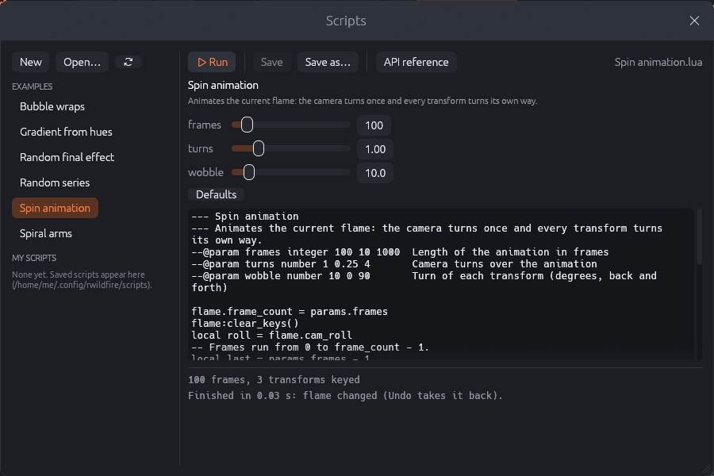

# Scripting

Scripts automate what would be tedious by hand: building flames from recipes, applying the same
change to many transforms, creating series of random flames, keying animations. RWildFire
scripts are written in **Lua 5.4**, a small, widely used scripting language. JWildfire's Java
scripts cannot run in RWildFire, but they translate almost line by line (see the end of this
chapter).

## The scripts window

**File › Scripts…** opens the scripts window.



- The list on the left shows the **Examples** that come with RWildFire and **My scripts**, the
  `.lua` files of your scripts folder (`~/.config/rwildfire/scripts` on Linux,
  `%APPDATA%\rwildfire\scripts` on Windows, or the Scripts folder set in the preferences).
  **New** starts a script from a short template, **Open…** opens a script from anywhere, ↻
  reads the folder again.
- At the top: **Run** (<kbd>Ctrl</kbd>+<kbd>Enter</kbd>), **Save**, **Save as…** (examples are
  saved as your own copy) and **API reference**, which opens Help › Scripting.
- Below: the script's title and description, and a **form with its parameters**. Change the
  values and run again; **Defaults** returns to the script's defaults.
- The **editor** shows the script's code. Changes are marked with a dot after the file name; when
  you switch to another script with unsaved changes, RWildFire asks first.
- The **output** at the bottom shows what the script prints and, in red, errors with the script
  name and line number, e.g. `my.lua:12: unknown variation 'julia3'`.

### What a run does

A script runs on a **copy** of the editor's flame, in the background: the editor stays usable,
and **Stop** ends a script that takes too long (or never ends). When the script finishes:

- If it changed the flame, the editor shows the result. It is **one undo step**, so
  <kbd>Ctrl</kbd>+<kbd>Z</kbd> brings back the flame from before the script.
- Flames the script created with `rwf.output(...)` appear in **Explore › File**.
- The output ends with a summary, e.g. "Finished in 0.03 s: flame changed (Undo takes it back)".

If the script fails or is stopped, the editor's flame stays unchanged.

## Example scripts

| Script | What it does |
|--------|--------------|
| Bubble wraps | Adds bwraps7, julian2 and bubble transforms with crossed xaos to the flame (a port of a JWildfire script). |
| Gradient from hues | Gives the flame a gradient that runs through a few hues. |
| Random final effect | Replaces the final transform with a random effect and randomizes its parameters. |
| Random series | Creates a series of random flames (shown in Explore › File). |
| Spin animation | Keys an animation: the camera turns, every transform wobbles. |
| Spiral arms | Builds a new spiral flame from two transforms. |

Open an example, look at its code, change a parameter and run it: the quickest way to learn the
API. Save your changes with **Save as…**.

## Writing a script

A script is a Lua file. The global `flame` is the editor's flame; the module `rwf` creates and
loads flames. A first script:

```lua
--- Twin spirals
--- Adds a second, mirrored copy of every transform.
--@param scale number 0.9 0.5 1.0  Size of the copies

local n = flame.xform_count
for i = 1, n do
  local copy = flame:xform(i):duplicate()
  copy.c00 = -copy.c00          -- mirror the x axis
  copy.c01 = -copy.c01
  copy:scale(params.scale)
end
print(("%d transforms copied"):format(n))
```

- The lines starting with `---` give the script its title and description.
- `--@param` lines declare parameters: name, type (`number`, `integer`, `bool` or `choice`),
  default, optional minimum and maximum, and a help text. The window builds the form from them;
  the script reads the values from `params`.
- `flame:xform(i)` returns a handle to transform *i* (counting from 1). Changing a handle's
  fields changes the flame directly.
- `print` writes to the output.

The complete list of functions follows.

{{api}}

## From JWildfire scripts to Lua

JWildfire scripts are Java classes with a `run(ScriptRunnerEnvironment pEnv)` method. The most
common pieces translate like this:

| JWildfire (Java) | RWildFire (Lua) |
|------------------|-----------------|
| `Flame f = pEnv.getCurrFlame();` | `local f = flame` |
| `XForm xf = new XForm(); f.getXForms().add(xf);` | `local xf = flame:add_xform()` |
| `xf.addVariation(0.5, VariationFuncList.getVariationFuncInstance("julia"))` | `xf:add_variation("julia", 0.5)` |
| `varFunc.setParameter("power", 3);` | `v.power = 3` |
| `xf.setWeight(2.0); xf.setColor(0.5); xf.setColorSymmetry(-1);` | `xf.weight = 2; xf.color = 0.5; xf.color_symmetry = -1` |
| `xf.setCoeff00(0.5);` … `setCoeff21(…)` | `xf.c00 = 0.5` … `xf.c21 = …` |
| `xf.getModifiedWeights()[2] = 0;` | `xf:set_chaos(3, 0)` (indices start at 1) |
| `f.getFinalXForms().add(xf);` | `flame:add_final_xform(...)` |
| `f.setCamRoll(30);` | `flame.cam_roll = 30` |
| `Math.random()` | `math.random()` or `rwf.random()` |
| `pEnv.refreshUI();` | not needed |

## Scripts on the command line

`rwf-cli script` runs scripts without the app, e.g. to generate flames in bulk:

```
rwf-cli script spiral.lua -o spiral.flame --param arms=5
rwf-cli script "Random series.lua" --param count=20 --flames series.flame
rwf-cli script --info my.lua          # show title, description and parameters
rwf-cli script --examples my-scripts  # copy the example scripts into a folder
```

Chapter "The command line" lists all options.
