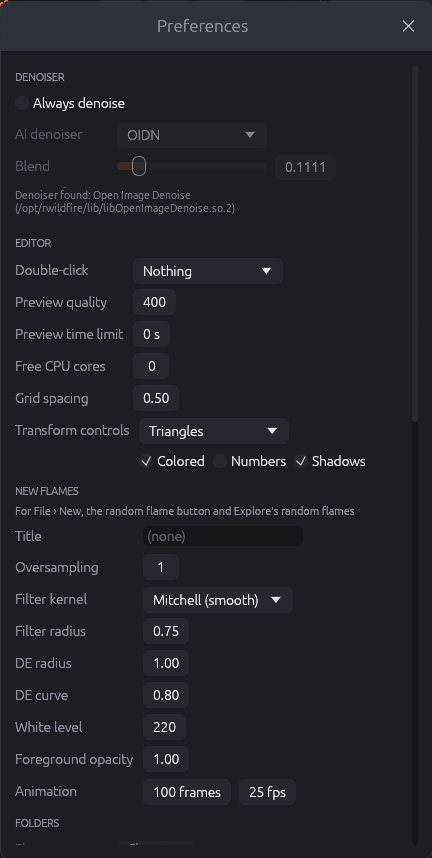
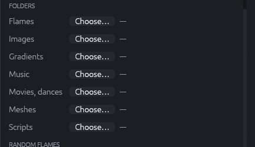
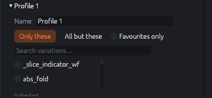
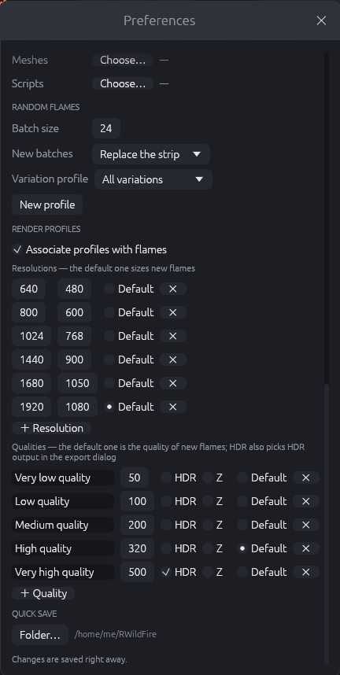

# Preferences

**Edit › Preferences…** opens the settings that stay between sessions. Every change is saved at
once into the preferences file (`~/.config/rwildfire/preferences.txt` on Linux,
`%APPDATA%\rwildfire\preferences.txt` on Windows); there is no OK button.

{: .half}

## Denoiser

- **Always denoise**: every flame that comes into the editor without a denoiser (new, random,
  Explore, MutaGen, opened files) gets the settings below, so saved images and renders are
  denoised. Flames that already have a denoiser keep theirs. The canvas shows the denoised
  image only with **Denoised** in the canvas toolbar.
- **AI denoiser** and **Blend**: the settings given to these flames (see "Render settings ›
  Denoiser").
- The line below says whether and where the denoiser library was found. If it was not found,
  flames still get the setting, but images are saved without denoising.

## Editor

- **Double-click**: what a double-click on the canvas does: *Nothing*, *Open the render window*
  or *Show/hide transform handles*.
- **Preview quality**: the quality up to which the editor preview renders (the Render tab's
  *Target quality* changes it for the current session only).
- **Preview time limit**: the preview stops refining after this many seconds; 0 means no limit.
  Useful on laptops to save power and keep the fan quiet.
- **Free CPU cores**: how many CPU cores the CPU renderer (preview, export, movies) and the
  Explore batches leave free for other programs. The line below shows how many are used.
- **Grid spacing**: the default spacing of the canvas grid (View › Grid).
- **Transform controls**: the look of the transform handles on the canvas: *Triangles* (as in
  JWildfire), *Rectangles* (parallelograms spanned by the two axes), *Axes* (only the two axis
  lines) or *Crosshairs*. **Colored** gives each transform its own color, **Numbers** writes the
  transform's number into its control, **Shadows** adds dark outlines for contrast on bright
  images.

## New flames

These settings are used for **File › New**, the **Random flame** button and the random flames
of the Explore strip (JWildfire's "tinaDefault…" preferences):

| Setting | Meaning |
|---------|---------|
| Title | Name of flames made with File › New (random flames keep their generator's name). |
| Oversampling | Spatial oversampling (1 = none). |
| Filter kernel, Filter radius | The spatial filter (0 turns it off). |
| DE radius, DE curve | Density estimation (radius 0 turns it off). |
| White level | Fade to white. |
| Foreground opacity | Opacity of the flame over a transparent background. |
| Animation | Length (frames) and frame rate of new flames' animations. |

The size and quality of new flames come from the default resolution and quality profiles
(below).

## Folders

{: .half}

The folders the file dialogs start in, per kind of file: **Flames**, **Images** (rendered
images, videos, background and texture images, render states), **Gradients**, **Music**,
**Movies, dances** (movie and dance projects), **Meshes** and **Scripts** (also the folder the
Scripts window lists; empty means the `scripts` folder next to the preferences file).
**Choose…** sets a folder; it is shown next to the button with a **×** that goes back to the
system's choice (usually the last folder used). "—" means no folder is set.

## Random flames

- **Batch size**: how many flames **New batch** in Explore › Random makes.
- **New batches**: where a new batch goes in the strip: *Replace the strip*, *Insert in front*
  or *Append at the end* (JWildfire's random batch refresh type).
- **Variation profile**: which variations the random generators may use (the same menu as in
  the top bar's random extras).

### Variation profiles

**New profile** creates a profile; open it to edit:

{: .half}

- **Name**.
- **Only these**: the generators use only the checked variations. **All but these**: they use
  every variation except the checked ones (e.g. to exclude slow or unwanted variations).
- **Favourites only**: use the favourites (marked with the star in the variation list) instead
  of a checked list.
- **Search variations…** filters the list; the line below shows how many are checked.
- **Delete profile** removes it.

The profile limits the variations the generators pick at random. Generators that are built
around particular variations (such as Bubbles or Julians) still use those.

## Render profiles

{: .half}

Profiles make often used sizes and qualities one click away in the export dialog and the batch
renderer.

- **Associate profiles with flames**: the export dialog starts with the profiles last chosen
  for a flame (saved in the flame file, as JWildfire's `resolution_profile` and
  `quality_profile`).
- **Resolutions**: width and height per profile. **Default** marks the size of new flames;
  **×** removes a profile, **+ Resolution** adds one.
- **Qualities**: name and quality per profile. **HDR** also chooses HDR output in the export
  dialog, **Z** the z-buffer. **Default** marks the quality of new flames.

## Quick save

**Folder…** sets where **File › Quick save** puts its flames (`qsave_<date>_<number>.flame`).
By default this is a folder `RWildFire` in your home folder.
